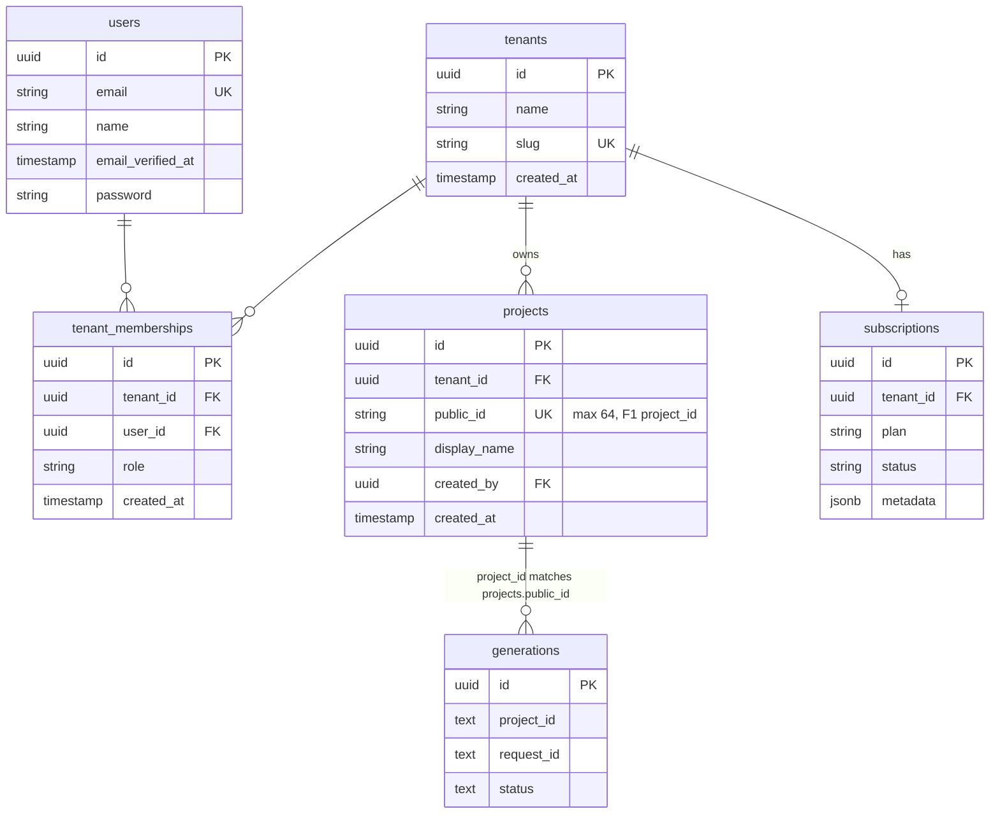

# Foundation & Identity — Laporan Audit Repo (Aliran A)

**Tarikh:** 25 November 2026 (UTC)  
**Kemas kini terakhir:** 25 November 2026 — keputusan pemilik **D-EMAIL-V** (APPROVED)  
**Repo:** `vividworks-site` @ `main` → `466c518` (*docs: Foundation & Identity audit report — commit terdahulu `12aa29f`*)  
**Skop:** AUDIT & DESIGN ONLY — tiada migrasi, ubah kod, SQL, n8n, deploy, atau push dilakukan dalam sesi ini.  
**Input rancangan:** `FOUNDATION-IDENTITY-ARCHITECTURE-v1.0.md` — **tidak dijumpai** dalam repo atau upload sesi ini; bandingan dengan v1.0 perlu dilakukan semula apabila fail itu dilampirkan.

---

## 1. Ringkasan eksekutif

| Bidang | Keadaan semasa (repo) | Arah yang disyorkan (menunggu kelulusan) |
|--------|------------------------|------------------------------------------|
| Identiti pelanggan | **Tiada** — model `User` skeleton, **tiada** migrasi `users`, **tiada** route auth | Laravel sebagai **satu-satunya authority** identiti; Sanctum untuk SPA + token API |
| Multi-tenant | **Tiada** | `tenants` + `tenant_memberships` + `projects` memegang `project_id` F1 |
| F1 `project_id` / `request_id` | **Beroperasi** sebagai string bebas; unik global `(project_id, request_id)` | Kekalkan kontrak F1; tambah **pautan** `projects` → tenant tanpa ubah state machine |
| Staging Supabase | 47 baris `generations`, **tiada** jadual auth (snapshot 25 Nov dalam `PROJECT-AUDIT`) | Backfill atau “sandbox system tenant”; jangan padam data ujian |
| Marketing React | CTA → `/akan-datang`; env `VITE_SAAS_*` belum disambung | SPA SaaS memanggil `api.*` dengan Sanctum cookie / Bearer |
| Pengesahan e-mel | Belum diimplementasi (`MustVerifyEmail` dikomen) | **DILULUSKAN:** wajib untuk semua pelan (Free/Grow/Pro/Elite); lihat §8.1 |
| PHPUnit F1 | Liputan luas dalam repo | Jalankan `./vendor/bin/phpunit` pada mesin dengan Composer (VM audit ini tiada `composer`) |

**Kesimpulan:** Backend F1 **matang** untuk mock/async lifecycle; lapisan Foundation & Identity **belum wujud** dalam kod atau migrasi. Implementasi identiti ialah **kerja baharu** yang perlu tidak mengganggu kontrak F1 atau 47 rekod staging.

---

## 2. Keadaan git & sempadan repo

- **Branch kerja:** `main` (bersih, selari `origin/main`).
- **Laravel:** `laravel/` — Laravel **13.17**, PHP **^8.3**, fasa B1 / F1 sahaja (`laravel/AGENTS.md`).
- **Marketing:** React + Express (`server/`) — **berasingan** daripada identiti Laravel; preview guna Express, bukan Laravel API.
- **CI:** Deploy preview untuk laman pemasaran; tiada pipeline khusus Laravel production dalam repo ini.

---

## 3. Inventori auth & identiti (semasa)

### 3.1 Model & migrasi

| Artifak | Status |
|---------|--------|
| `app/Models/User.php` | Skeleton `Authenticatable`; `MustVerifyEmail` **dikomen** |
| Migrasi `users` / `password_reset_tokens` / `sessions` | **Tiada** dalam `laravel/database/migrations/` |
| `database/factories/UserFactory.php` | Wujud (untuk ujian masa depan) |
| Jadual F1 | `inquiries`, `generations`, `generation_attempts`, `generation_contexts`, + lifecycle: `callback_inbox`, `generation_outbox`, `generation_audit_events`, `generation_reopens` |

### 3.2 Konfigurasi auth

- `config/auth.php`: guard `web` (session) sahaja; provider `users` → `User::class`.
- **Tiada** guard `sanctum`, **tiada** `laravel/sanctum` dalam `composer.json`.
- `config/cors.php`: paths kosong — sesuai dengan “tiada SPA ke API Laravel” hari ini; **mesti** dikonfigurasi semasa SaaS SPA hidup.
- `config/session.php`: driver `file` (default `.env.example`).

### 3.3 Routes & middleware

`laravel/routes/api.php`:

| Method | Laluan | Auth |
|--------|--------|------|
| GET | `/health` | Awam |
| POST | `/contact` | Awam + rate limit |
| GET | `/inquiries` | `ADMIN_TOKEN` Bearer (404 jika token kosong) |
| POST | `/ai/design-generations` | **Awam** |
| POST | `/ai/design-callback` | `VIVIDAI_CALLBACK_TOKEN` (middleware) |

`routes/web.php`: welcome sahaja. **Tiada** register, login, password reset, atau `/sanctum/csrf-cookie`.

`bootstrap/app.php`: API throttle default; `RejectOversizedJson` pada kumpulan `api`; tiada middleware auth global.

### 3.4 Corak “auth” bukan pelanggan

1. **`VIVIDAI_CALLBACK_TOKEN`** — integrasi n8n → Laravel (bukan pengguna).
2. **`ADMIN_TOKEN`** — senarai inquiries (sama pola pada Express marketing).
3. **F1 POST design-generations** — sesiapa boleh cipta generation jika endpoint terdedah (risiko production sehingga identiti atau gateway ditambah).

---

## 4. Kontrak F1 — pengesahan berdasarkan kod

| Perkara | Dokumen / pelan | Kod & skema repo | Nota |
|---------|-----------------|------------------|------|
| `project_id` | String, max **64** aksara | `DesignGenerationService::text(..., 64)`; DB `text` **tanpa** CHECK panjang | Validasi aplikasi mematuhi; PG boleh tambah CHECK pada fasa identiti **tanpa** ubah format |
| `request_id` | String, max **100** aksara | `text(..., 100)`; DB `text` | Sama seperti atas |
| Unik `(project_id, request_id)` | Ya | Unique index `generations_project_request_unique` | Jangan ubah |
| State machine generation/attempt | Dikunci ujian | `F1MockDispatcher`, partial unique `generation_attempts_one_open_unique`, callback rules | **Jangan** ubah dalam fasa identiti tanpa kelulusan F1 |
| `job_id` padanan callback | Ketat | Unique partial index + semantic gate | Kekal |
| Staging stub | POST awam → `unknown` invoke | `UnknownDesignInvokeStub` | Berasingan daripada identiti pelanggan |

Rujukan validasi panjang:

```179:187:laravel/app/Support/DesignGenerationService.php
        $projectId = $this->text($input, 'project_id', 64);
        if ($projectId === null) {
            $errors['project_id'] = 'project_id is required.';
        }

        $requestId = $this->text($input, 'request_id', 100);
        if ($requestId === null) {
            $errors['request_id'] = 'request_id is required.';
        }
```

---

## 5. Integrasi F1 dengan identiti (lacuna)

Hari ini `project_id` ialah **pemilih bebas** yang dibekalkan oleh pemanggil API. Tiada:

- Foreign key ke `users` atau `tenants`
- Penjanaan `project_id` terkawal oleh backend
- Semakan “pemilik projek” sebelum invoke atau callback (callback hanya semak konsistensi dengan baris `generations` sedia ada)

**Implikasi produk:** Free plan → website memerlukan:

1. Pengguna didaftarkan → tenant (peribadi atau organisasi) → **projek** dengan `project_id` stabil.
2. `POST /api/ai/design-generations` hanya untuk token/session yang mempunyai akses ke `project_id` tersebut **dan** pengguna **telah mengesahkan e-mel** (D-EMAIL-V).
3. n8n W2/W1 terus menerima `project_id`/`request_id` dalam body yang sama — **tiada perubahan kontrak n8n** jika Laravel kekal penjana nilai.

---

## 6. Cadangan skema (reka bentuk v1.1 — menunggu banding dengan v1.0)

Prinsip: **tambah jadual identiti**, pautkan `projects.public_id` (= string F1 `project_id`), **jangan** rename atau pecah jadual F1 sedia ada.

### 6.1 ERD (cadangan)



### 6.2 Jadual & kekangan (PostgreSQL)

| Jadual | Lajur penting | Indeks / FK |
|--------|---------------|-------------|
| `users` | Laravel standard + `uuid` PK (disyorkan selari F1) | `email` unique |
| `tenants` | `name`, `slug` | `slug` unique |
| `tenant_memberships` | `role` ∈ `owner`, `admin`, `member` (minimum) | unique `(tenant_id, user_id)` |
| `projects` | `public_id` varchar(64), `tenant_id` | **unique `public_id`** (global — sejajar F1 hari ini); FK `tenant_id` |
| `subscriptions` | `plan` ∈ `free`,`grow`,`pro`,`elite` (selari F1 package) | FK `tenant_id`; satu “aktif” per tenant (peraturan perniagaan) |

**Tiada** foreign key DB dari `generations.project_id` → `projects.public_id` pada fasa pertama (elak lock pada 47 baris legacy); gunakan **validasi aplikasi** + backfill berperingkat.

### 6.3 Peranan & ownership

| Peranan | Kebenaran minimum |
|---------|-------------------|
| `owner` | Urus langganan, jemput ahli, cipta/padam projek (ikut polisi) |
| `admin` | Cipta generation, urus projek |
| `member` | Cipta generation pada projek yang dibenarkan |

**Tenant resolution:** pada setiap permintaan API SaaS, resolve `tenant_id` dari (a) header `X-Tenant-Id` / subdomain, atau (b) konteks projek dalam URL — **keputusan terbuka** (§8).

---

## 7. Laravel Sanctum — penilaian

| Gunakan Sanctum? | **Ya**, sebagai lalai |
|------------------|----------------------|
| SPA (React SaaS pada subdomain) | `sanctum` guard + cookie CSRF ke `api.vividworks.my` / staging |
| Token peranti / CLI / integrasi | Personal access tokens |
| Mengapa bukan Supabase Auth sebagai authority? | Pelan kerja + `WORKFLOW` menekankan **Laravel satu authority**; Supabase Production kekal **Postgres** untuk Laravel (boleh elak dual-auth) |
| Supabase RLS | **Opsional** — jika semua akses melalui Laravel dengan connection role tunggal, RLS boleh ditangguhkan; jika client PG langsung di masa depan, RLS diperlukan |

**Tindakan implementasi (fasa akan datang, bukan hari ini):** `composer require laravel/sanctum`, migrasi `personal_access_tokens`, route auth, `EnsureFrontendRequestsAreStateful`, CORS `supports_credentials` + `allowed_origins` untuk domain SaaS.

### 7.1 Aliran yang perlu direka (tiada dalam repo)

| Aliran | Status repo | Acceptance criteria |
|--------|-------------|----------------------|
| Pendaftaran | Tiada | Cipta user **unverified** (`email_verified_at` null); hantar e-mel pengesahan; cipta tenant peribadi + membership `owner` hanya selepas verify **atau** cipta tenant tetapi gate API kekal (lihat D-EMAIL-V) |
| Login / logout | Tiada | Session Sanctum sah untuk pengguna unverified; logout membatalkan token |
| Email verification | Model sedia, tidak wajib | **D-EMAIL-V APPROVED:** wajib semua pelan; `User` implements `MustVerifyEmail`; middleware `verified` pada cipta projek & F1 invoke |
| Resend verification | Tiada | Endpoint berthrottle; sah hanya untuk session pengguna unverified |
| Password reset | Config `passwords.users` sahaja | Mailer production + throttle |
| Tenant resolution | Tiada | Request scope konsisten; 403 jika tiada membership |
| Cipta projek + `public_id` | Tiada | `public_id` mematuhi 64 aksara; unik global; **403 atau 409** jika e-mel belum disahkan |

---

## 8. Keputusan yang memerlukan pemilik (Khairul)

### 8.1 Keputusan diluluskan

#### D-EMAIL-V — Pengesahan e-mel (**APPROVED**, 25 Nov 2026)

**Status:** Pengesahan e-mel **wajib** untuk semua pengguna VividWorks, **tanpa mengira pelan** langganan: Free, Grow, Pro, dan Elite.

**Peraturan produk & teknikal (implementasi fasa I1–I3):**

1. Akaun baharu diwujudkan dalam status **unverified** (`email_verified_at` = null).
2. Pengguna **boleh log masuk** selepas pendaftaran; sesi/auth asas SaaS dibenarkan.
3. **Akses fungsi SaaS terhad** untuk unverified: tidak boleh **mencipta projek** dan tidak boleh memanggil **AI generation** (`POST /api/ai/design-generations` atau laluan setara fasa akan datang).
4. Pengguna **wajib mengesahkan e-mel** sebelum cipta projek atau gunakan AI generation.
5. Sediakan **resend verification email** (endpoint dedikasi, rate-limited).
6. **Laravel** ialah authority status pengesahan: model `User` mengimplement `Illuminate\Contracts\Auth\MustVerifyEmail`; semakan melalui middleware `verified` (ataupun setara) pada route/project/policy berkaitan — bukan Supabase Auth.

**SaaS terhad (contoh skop guard untuk unverified):**

| Kebenaran | Unverified | Verified |
|-----------|------------|----------|
| Login / logout / profil asas / resend verify | ✅ | ✅ |
| Cipta atau urus projek | ❌ | ✅ (ikut role) |
| AI design generation (F1) | ❌ | ✅ (ikut project access) |
| Langganan / billing (fasa I4) | ❌ (atau baca sahaja — ikut UI) | ✅ |

**Nota reka bentuk:** Laravel `verified` middleware biasanya membalas HTTP 403; SPA harus memaparkan halaman “Sahkan e-mel anda” + butang resend, bukan sekadar ralat generik.

---

### 8.2 Keputusan masih terbuka

| ID | Topik | Pilihan | Implikasi |
|----|-------|---------|-----------|
| D-PID-FMT | Format `project_id` **baru** | (A) UUID tanpa sempang 32 char (B) `vw_` + ulid (C) slug bisnes | Panjang max 64; keterbacaan vs collision |
| D-PID-GLOBAL | Unik global `project_id` | Kekal seperti F1 (ya) vs per-tenant unik sahaja | F1 & staging **sudah** global unique — tukar akan pecahkan kontrak |
| D-LEGACY-47 | 47 `generations` staging | (A) tenant sistem `legacy-staging` (B) biarkan tanpa `projects` row (C) backfill manual | Tidak padam; tidak campur production |
| D-RLS | Supabase RLS | Laravel-only vs RLS per tenant | Kompleksiti operasi |
| D-ONBOARD | Onboarding tenant | Auto tenant per user vs pasukan kemudian | Aliran UI `/akan-datang` |
| D-INQUIRIES | `inquiries` marketing | Postgres sama dengan F1 prod vs asing | §15 PROJECT-AUDIT masih terbuka |
| D-GEN-AUTH | Siapa boleh POST design-generations | Token user sahaja vs API key per projek | Keselamatan production; **tambahan:** mesti `verified` (D-EMAIL-V) |

**Percanggahan dengan v1.0:** tidak dapat disenaraikan tanpa fail `FOUNDATION-IDENTITY-ARCHITECTURE-v1.0.md`. Sila lampirkan untuk semakan Guru.

---

## 9. Staging: 47 rekod `generations`

Snapshot (`docs/PROJECT-AUDIT-2026-11-24.md` §14): 47 generations, 50 attempts, tiada `users`.

| Strategi | Langkah | Rollback |
|----------|---------|----------|
| **Disyorkan (konservatif)** | Cipta `tenants.slug = legacy-staging-test` + projek sintetik hanya untuk `project_id` yang mahu diuji end-to-end; biarkan selebihnya tanpa baris `projects` | Tiada sentuh `generations` |
| **Backfill penuh** | Skrip baca distinct `project_id` dari staging → cipta `projects` + tenant sistem | Backup snapshot Supabase sebelum skrip |
| **Production** | Jangan salin 47 baris ke production DB | N/A |

**Ujian staging khas:** Pasangan 64×`a` + 100×`b` dan generation `5fb6e47c-...` **dilarang** diguna semula (`f1-dan-ujian-staging`).

---

## 10. Urutan implementasi (selepas kelulusan)

| Fasa | Skop | Gate |
|------|------|------|
| **I0** | Kelulusan reka bentuk + keputusan §8 | Khairul + semakan v1.0 |
| **I1** | Migrasi `users`, Sanctum, register/login/**verify + resend**/reset; `MustVerifyEmail`; **tanpa** sentuh F1 | PHPUnit: unverified blocked from guarded routes; F1 suite hijau |
| **I2** | `tenants`, `tenant_memberships`, `projects`; policy + resolution; **`verified` pada cipta projek** | Integration: unverified tidak boleh cipta projek |
| **I3** | Lindungi `POST design-generations` (auth + **verified** + project ownership) | F1 regression; unverified → 403 |
| **I4** | `subscriptions` (free tier minimum) | Product |
| **I5** | React SaaS env + ganti `/akan-datang` | E2E |
| **I6** | Backfill staging optional | Backup |

**Rollback:** snapshot DB sebelum I1; feature flag `F1_PUBLIC_INVOKE` untuk revert sementara ke invoke awam (hanya staging darurat).

---

## 11. Senarai fail yang **akan** berubah (fasa implementasi — tidak disentuh hari ini)

### Laravel baru / besar

- `composer.json` — `laravel/sanctum`
- `database/migrations/*_create_users_table.php` (dan Sanctum)
- `database/migrations/*_tenants_*.php`, `*_projects_*.php`, `*_subscriptions_*.php`
- `routes/api.php` — kumpulan auth, middleware pada F1
- `config/auth.php`, `config/cors.php`, `config/sanctum.php` (published)
- `app/Http/Controllers/Api/Auth/*` atau Fortify (pilihan) — termasuk **resend verification**
- Middleware `verified` pada route projek & design-generations (fasa I2/I3)
- `app/Models/Tenant.php`, `Project.php`, `TenantMembership.php`, `Subscription.php`
- `app/Policies/ProjectPolicy.php`
- `tests/Feature/Auth/*` (termasuk verify + resend), `tests/Feature/ProjectAccessTest.php`, `tests/Feature/VerifiedEmailGateTest.php` (unverified → projek/F1 ditolak)

### Laravel sedia ada (sentuhan terhad)

- `app/Http/Controllers/Api/DesignGenerationController.php` — resolve project + authorize
- `app/Support/DesignGenerationService.php` — optional: validate project exists
- `app/Models/User.php` — relationships; nyahkomen / aktifkan **`MustVerifyEmail`** (D-EMAIL-V)
- `bootstrap/app.php` — middleware aliases

### React / marketing (fasa SaaS)

- `src/lib/actions.ts`, `src/env.d.ts` — URL API Laravel
- App SaaS baharu atau route di luar marketing

### Tidak dijangka berubah

- Kontrak body n8n / W1 / W2
- `F1MockDispatcher` state machine
- Migrasi F1 sedia ada (kecuali ADD nullable FK pilihan jauh masa depan)

---

## 12. Risiko

| Risiko | Keterukan | Mitigasi |
|--------|-----------|----------|
| F1 endpoint awam di production | Tinggi | Auth pada I3; WAF/rate limit sementara |
| Dual auth Supabase + Laravel | Sederhana | Laravel-only authority |
| `project_id` collision selepas penjana automatik | Sederhana | ULID/UUID + unique index `projects.public_id` |
| CORS misconfiguration SPA | Sederangan | Ujian staging dengan domain tepat |
| Backfill staging rosak data | Rendah jika tidak sentuh generations | Tenant legacy + backup |
| PHPUnit tidak dijalankan dalam VM audit | Rendah | Jalankan pada KS-3 / dev sebelum I1 merge |

---

## 13. Ujian (repo)

| Suite | Fail |
|-------|------|
| F1 lifecycle | `tests/Feature/F1MockLifecycleTest.php` |
| Design generation | `tests/Feature/DesignGenerationTest.php` |
| Callback | `tests/Feature/DesignCallbackTest.php` |
| Inquiry | `tests/Feature/InquiryApiTest.php` |

**Sesi audit:** `composer` tidak tersedia pada VM agent; **tidak** dijalankan semula di sini. Jalankan `cd laravel && composer install && ./vendor/bin/phpunit` sebagai gate sebelum sebarang fasa implementasi.

---

## 14. Acceptance criteria

### 14.1 Aliran A — audit (sesi asal)

| Kriteria | Status |
|----------|--------|
| Laporan berasaskan repo semasa | ✅ Fail ini |
| ERD + skema cadangan | ✅ §6 |
| Kontrak F1 disahkan | ✅ §4 |
| Keputusan pemilik disenaraikan | ✅ §8 |
| Pelan migrasi berperingkat + rollback | ✅ §9–10 |
| Senarai fail masa depan tanpa ubah kod | ✅ §11 |
| Tiada migrasi/kod/SQL/n8n/deploy/push | ✅ |

### 14.2 D-EMAIL-V — bila fasa identiti dilaksanakan (rujukan kelulusan)

| # | Kriteria | Rujukan |
|---|----------|---------|
| E1 | Pendaftaran mencipta pengguna dengan `email_verified_at` null; e-mel pengesahan dihantar | §8.1 peraturan 1 |
| E2 | Login berjaya untuk unverified; token/session sah | §8.1 peraturan 2 |
| E3 | Unverified: **403** (atau kontrak API yang dipersetujui) pada cipta projek | §8.1 peraturan 3–4, §7.1 |
| E4 | Unverified: **403** pada `POST /api/ai/design-generations` | §8.1 peraturan 3–4; fasa I3 |
| E5 | Verified: cipta projek dan invoke generation dibenarkan mengikut policy/role sedia ada | §8.1 jadual SaaS |
| E6 | Endpoint **resend verification** wujud, berthrottle, hanya untuk pemilik session unverified | §8.1 peraturan 5 |
| E7 | `User` implements **`MustVerifyEmail`**; Laravel (bukan Supabase Auth) menentukan status verify | §8.1 peraturan 6 |
| E8 | Pelan Free, Grow, Pro, Elite — **tiada pengecualian** verifikasi e-mel | §8.1 APPROVED |
| E9 | PHPUnit/feature tests meliputi E1–E6; suite F1 sedia ada kekal hijau | §10 I1–I3 |

**Status dokumentasi D-EMAIL-V:** ✅ direkod dalam §8.1; menunggu fasa implementasi (bukan skop hari ini).

---

## 15. Langkah seterusnya (manusia)

1. Khairul: lampirkan `FOUNDATION-IDENTITY-ARCHITECTURE-v1.0.md` → bandingkan §6–8 dengan v1.0; tandakan percanggahan.
2. Luluskan atau betulkan keputusan **§8.2** (§8.1 **D-EMAIL-V** sudah APPROVED).
3. Keluarkan arahan implementasi **berasingan** (Aliran B / production boleh berjalan selari dengan ChatGPT pada KS-3).
4. Selepas I1 dimulakan: buka PR khusus identiti; **jangan** campur dengan deploy Laravel production tanpa gate F1.

---

*Dijana oleh Cursor Cloud Agent — Aliran A, 25 Nov 2026.*