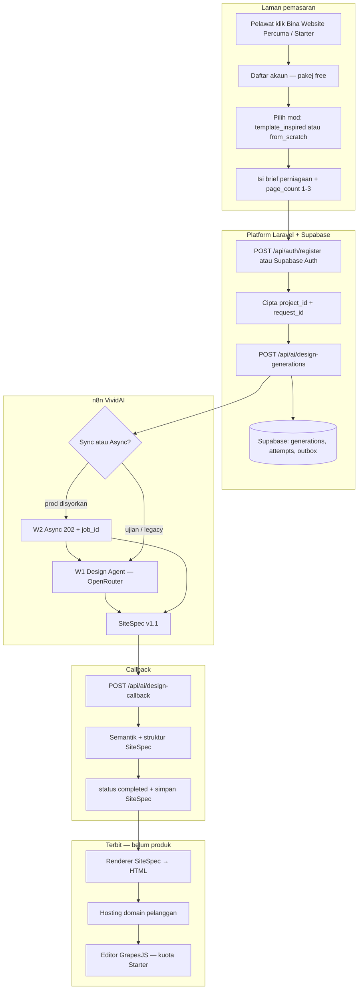
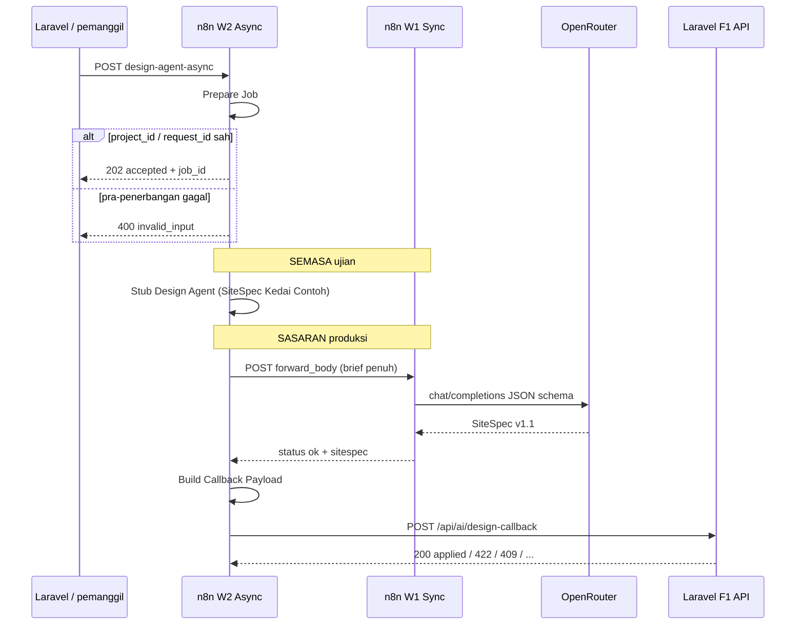

# Aliran pelanggan: Free / Starter plan → website (vividworks)

**Versi:** 1.1 (25 November 2026, UTC+8)  
**Audience:** ChatGPT, Cursor, dan pemilik produk  
**Penting:** Bahagian **SASARAN** menerangkan produk yang dirancang. Bahagian **SEMASA** menerangkan apa yang benar-benar hidup hari ini.

---

## 1. Ringkasan status komponen

| Komponen | Peranan | Status | Catatan |
|----------|---------|--------|---------|
| **Laman pemasaran** (`vividworks-site`) | UI BM, borang hubungi, pratonton templat | **Live preview** | https://preview.vividworks.my — Express API, **bukan** Laravel |
| **Laravel F1 API** (`laravel/` dalam repo) | `design-generations`, `design-callback`, inquiries | **Dibina + diuji** | Staging: `api-staging.vividworks.my` (dirujuk n8n). **Tidak** disambung ke laman pemasaran |
| **Supabase** `vividworks-staging` | Postgres untuk F1 | **Aktif** | 47 `generations`, inbox/callback/outbox — **tiada** jadual `users` / auth pelanggan |
| **n8n W1** “VividAI - Design Agent” | Webhook sync → OpenRouter → SiteSpec | **Diterbitkan** (`active`) | Terima `package: free` (dan grow/pro/elite). URL prod: `https://n8n.vividai.my/webhook/vividai/design-agent` |
| **n8n W2** “VividAI - Design Agent (Async)” | 202 + callback ke Laravel | **Draf** (`active: false`) | Stub “Kedai Contoh”, nod **Call Design Agent dilumpuhkan**. **Jangan terbitkan** tanpa kelulusan (rekod 22 Nov) |
| **Pendaftaran pelanggan / Starter RM0** | Akaun, kuota AI, editor | **Belum dibuka** | Marketing: butang → `/akan-datang` |
| **Renderer / terbit website** | HTML/CSS/JS pelanggan | **Luar skop repo marketing** | SiteSpec sahaja dalam F1 setakat ini |

**Kesimpulan jujur:** **AI Generate (W1) + Laravel + Supabase staging berjaya sebagai kepingan backend.** **Tiada satu aliran end-to-end** dari “pelanggan daftar free” hingga “website boleh dilihat” yang sudah disambungkan kepada laman pemasaran.

---

## 2. Aliran SASARAN (produk lengkap)



### Had pakej Starter (spesifikasi marketing, belum dilancarkan)

- RM0, 1–3 halaman statik, 1× AI Generate, 2× AI Edit (belum ada), GrapesJS selepas kredit habis, output HTML/CSS/JS, tiada DB khusus website pelanggan.

### Kontrak teknikal F1 (sudah dikunci dalam kod Laravel + n8n)

- `project_id` (≤64), `request_id` (≤100), `package` ∈ `free|grow|pro|elite`, `page_count` ∈ {1,2,3}, `active_templates` dari Laravel, callback ikat `job_id`, SiteSpec `schema_version` **1.1** sahaja.

---

## 3. Aliran SEMASA (apa yang pelanggan benar-benar alami)

```mermaid
flowchart LR
  subgraph today [Hari ini]
    T1[preview.vividworks.my]
    T2[/akan-datang]
    T3[POST /api/contact — Express]
    T4[(Fail inquiries pada container)]
  end

  T1 -->|Bina Website Percuma| T2
  T1 -->|Hubungi Kami| T3 --> T4

  subgraph backend [Backend F1 — tidak dari UI marketing]
    B1[api-staging.vividworks.my]
    B2[n8n W1 webhook]
    B3[Supabase staging]
  end

  T1 -.->|tiada pautan| B1
  B1 <-- callback --> B2
  B1 --> B3
```

---

## 4. Urutan mesej (Async — laluan produk disyorkan)

Ini menerangkan **W2 + Laravel** selepas pendaftaran wujud. W2 **belum diterbitkan**; ujian guna stub (lihat `docs/f1-dan-ujian-staging-2026-11-22.md`).

| Langkah | Pelaku | Tindakan | HTTP / hasil |
|--------|--------|----------|----------------|
| 1 | Frontend / Laravel | Pelanggan `package: free`, hantar brief + `active_templates` | — |
| 2 | Laravel | Persist generation + attempt, panggil n8n async webhook | — |
| 3 | n8n W2 | Validasi `project_id`, `request_id` | **202** + `job_id` |
| 4 | n8n | (Sasaran) panggil W1 atau model; (Sekarang) stub SiteSpec | — |
| 5 | n8n | `POST /api/ai/design-callback` ke Laravel | Bearer callback |
| 6 | Laravel | Semantik/struktur, kemas kini `generations` | 200 applied / 422 / 409 |
| 7 | Platform | (Belum) render + URL live + editor | — |

---

## 5. Urutan mesej (Sync — W1 sahaja)

Untuk ujian atau integrasi langsung tanpa W2:

1. Client `POST https://n8n.vividai.my/webhook/vividai/design-agent` + header `X-VividAI-Key`  
2. Badan termasuk `package: "free"`, `design_mode`, `business`, `page_count`, `active_templates`, dll.  
3. Respons sync: `status: ok` + `sitespec` **atau** ralat berstruktur (`schema_version` 1.1).  
4. Laravel boleh memanggil W1 dari `DesignGenerationService` (staging: stub `unknown` pada POST awam tanpa job_id — lihat doc F1).

---

## 6. Rujukan fail dalam repo

| Topik | Fail |
|-------|------|
| API Laravel | `laravel/routes/api.php` |
| Kitaran F1 + ujian staging | `docs/f1-dan-ujian-staging-2026-11-22.md` |
| Rancangan ujian n8n A7 | `vividworks-f1-a7-isolated-n8n-runtime-test-plan-v12.md` |
| Deploy marketing | `README.md` § Deployment |
| Audit sesi 24–25 Nov | `docs/PROJECT-AUDIT-2026-11-24.md` |

---

## 7. Langkah seterusnya untuk melengkapkan aliran free → website

1. **Auth & project** — Supabase Auth atau Laravel users; jadual `projects` / pautan `project_id` kepada akaun.  
2. **Ganti `/akan-datang`** — `VITE_SAAS_REGISTER_URL` + UI daftar yang memanggil backend.  
3. **Sambung marketing → Laravel** — env API staging/prod pada app SaaS (bukan Express marketing semasa).  
4. **Terbitkan W2** — hanya selepas `Call Design Agent` dihidupkan, kelulusan pemilik, dan ujian baki (item “Belum diuji” dalam doc F1).  
5. **Renderer + hosting** — terbitkan SiteSpec ke URL pelanggan; editor GrapesJS + kuota Starter.  
6. **Production** — `vividworks.my` marketing, prod DB, monitoring (lihat audit §7).

---

## 8. Deep-dive: n8n W2 (VividAI – Design Agent Async)

Rujukan kod/workflow: workflow ID **`sdbCW1olkS0QeMFf`**, nama **“VividAI - Design Agent (Async)”**. Kemas kini terakhir dilaporkan **24 Nov 2026**. Status: **`active: false`**, `activeVersionId: null` (tidak diterbitkan).

### 8.1 Mengapa W2 wujud (berbanding W1 sahaja)

| | W1 `fg1kGKB6ciYADxu9` | W2 `sdbCW1olkS0QeMFf` |
|---|------------------------|-------------------------|
| Webhook | `POST …/vividai/design-agent` | `POST …/vividai/design-agent-async` |
| Respons kepada pemanggil | **Tunggu** sehingga AI + validasi SiteSpec selesai | **202 Accepted** + `job_id` (tidak tunggu AI) |
| Masa | Boleh ~3 min (OpenRouter + 18 nod) | Respons awal < 1 saat; hasil melalui callback |
| AI | OpenRouter dalam workflow | **Sasaran:** panggil W1; **Sekarang:** stub |
| Laravel | Boleh dipanggil langsung (ujian) | **`POST /api/ai/design-callback`** wajib untuk hasil |

**Inti:** Laravel memegang `generation` / `attempt` di Supabase; client tidak memegang socket HTTP semasa AI berjalan.

### 8.2 URL dan auth

| Titik akhir | URL |
|-------------|-----|
| W2 webhook (prod) | `https://n8n.vividai.my/webhook/vividai/design-agent-async` |
| W2 webhook (test) | `https://n8n.vividai.my/webhook-test/vividai/design-agent-async` |
| W1 (dipanggil dari W2 bila dihidupkan) | `https://n8n.vividai.my/webhook/vividai/design-agent` |
| Callback Laravel staging | `https://api-staging.vividworks.my/api/ai/design-callback` |

- Webhook W2: header **`X-VividAI-Key`** (Header Auth account dalam n8n).
- Callback ke Laravel: credential **“VividAI Laravel callback”** (HTTP header auth pada nod `Send Result to Laravel`).

### 8.3 Diagram jujukan (sasaran vs semasa)



### 8.4 Senarai nod (9 nod) dan tugas

| # | Nama nod | Jenis | Fungsi |
|---|----------|-------|--------|
| 1 | Design Request Async | Webhook | Terima POST; `responseMode: responseNode` |
| 2 | Prepare Job | Code | Pra-validasi: `project_id`, `request_id`; jana `job_id`; simpan `forward_body` |
| 3 | Job Acceptable? | IF | `status_gate === accepted` |
| 4 | Respond Accepted | Respond to Webhook | **HTTP 202** + badan `accepted` |
| 5 | Respond Rejected | Respond to Webhook | **HTTP 400** jika pra-penerbangan gagal |
| 6 | Call Design Agent | HTTP Request | **DISABLED** — POST ke W1 dengan `forward_body` |
| 7 | Stub Design Agent | Code | **Aktif ujian** — SiteSpec tetap “Kedai Contoh” |
| 8 | Build Callback Payload | Code | Bentuk badan callback (ok / error, latency, job_id) |
| 9 | Send Result to Laravel | HTTP Request | POST callback; `neverError: true` |

**Kumpulan UI n8n:** *Accept request* (2–5); *Generate and deliver spec* (6–9).

### 8.5 Kontrak pra-penerbangan W2 (Prepare Job)

W2 **tidak** menggantikan validator penuh W1. Pada Prepare Job sahaja:

| Medan | Syarat |
|-------|--------|
| `body` | Objek JSON |
| `project_id` | Wajib, string, ≤64 aksara selepas trim |
| `request_id` | Wajib, string, ≤100 aksara selepas trim |

Selepas lulus:

- `job_id` = `job_` + base36 timestamp + `_` + random.
- `forward_body` = badan asal (akan dihantar ke W1 apabila nod 6 dihidupkan).

**Respons 202 (contoh bentuk):**

```json
{
  "schema_version": "1.1",
  "status": "accepted",
  "job_id": "job_mwryjxqn_3z6zkw",
  "project_id": "…",
  "request_id": "…",
  "accepted_at": "2026-11-22T14:54:00.000Z",
  "message": "The design job was accepted. The result will be POSTed to the configured Laravel callback."
}
```

Validasi `package`, `page_count`, `business`, `active_templates`, dll. berlaku pada **W1** apabila `forward_body` dihantar — bukan pada Prepare Job.

### 8.6 Build Callback Payload — logik utama

Input: output **Stub Design Agent** atau (sasaran) **Call Design Agent** (full response W1).

| Keadaan | Callback `status` | Laravel biasanya |
|---------|-------------------|------------------|
| `item.error` (rangkaian) | `error`, `agent_unreachable`, `retryable: true` | Gagalkan generation; **tiada** attempt auto baharu |
| Tiada JSON parseable | `invalid_agent_response`, 502 | Idem |
| W1 `status: ok` + `sitespec` | `ok` + `sitespec`, metadata, `usage` | `applied: true`, attempt `completed` |
| W1 `status: error` | Salin `error_code`, `retryable`, `details` | Ikut `DesignCallbackRules` |

**Peraturan yang dikunci oleh ujian staging (22 Nov)** — Laravel, bukan n8n:

- `error.message` **menang** atas badan `status: ok` + SiteSpec (pelaksanaan 113).
- `statusCode` HTTP (contoh 200) boleh **menang** atas `http_status` dalam badan JSON (pelaksanaan 117).
- `retryable` sebagai rentetan `"true"` → dibaca sebagai **bukan** boolean true (pelaksanaan 116).
- Callback ralat **tidak** boleh membawa `usage` (pelaksanaan 115).
- `details` mesti **objek**, bukan array (pelaksanaan 114).

Rujuk senarai pelaksanaan 82–118 dalam `docs/f1-dan-ujian-staging-2026-11-22.md`.

### 8.7 Laravel sebagai otoriti (bukan n8n)

| Laravel | n8n W2 |
|---------|---------|
| `POST /api/ai/design-generations` — cipta `generations`, `attempts`, konteks | Terima invoke (masa depan) / ujian manual |
| Padan `job_id` pada callback | Hantar `job_id` yang sama dalam callback |
| Semantik + struktur SiteSpec v1.1 | Hanya hantar payload; W1 yang hasilkan SiteSpec |
| Putuskan retry / attempt baharu | `retryable` = **petunjuk diagnostik sahaja** |
| Staging: `UnknownDesignInvokeStub` → invoke **unknown**, **tidak** panggil W2 pada POST awam mock | — |

**Ujian W2:** operator merekod baris `accepted_202` + `job_id` (reflection/mock), kemudian picu W2 atau callback selari dengan `job_id`.

### 8.8 Status kejayaan W2 (checklist)

| Item | Ya / tidak |
|------|------------|
| Workflow disimpan, 9 nod, boleh dieksekusi manual | **Ya** |
| Diterbitkan untuk trafik produksi | **Tidak** |
| Callback ke `api-staging` berfungsi | **Ya** (banyak ujian 22 Nov) |
| AI sebenar (W1 → OpenRouter) dalam laluan W2 | **Tidak** (stub + W1 disabled) |
| Pelanggan dari laman pemasaran | **Tidak** |
| Doc: “Jangan terbitkan W2” / jangan picu webhook prod tanpa guard | **Masih berkuat** |

### 8.9 Bila boleh terbitkan W2 (syarat dari rekod projek)

1. Kelulusan pemilik (sembilan keputusan OPEN dalam doc F1, 22 Nov).
2. Hidupkan **Call Design Agent** (buang stub atau toggel persekitaran).
3. Sahkan item **Belum diuji** dalam doc F1 (contoh: `message` + `description` serentak pada `item.error`).
4. Laravel prod/staging memanggil W2 selepas `design-generations` dengan env `VIVIDAI_DESIGN_AGENT_URL` (async URL).
5. Pantau: nod `Send Result to Laravel` dengan `neverError: true` — **422/409 di Laravel tidak failkan n8n**; semak audit di Supabase.

### 8.10 Perbandingan beban: pra-penerbangan W2 vs W1

W1 **Validate Request** mengesahkan antara lain: `package` ∈ {free, grow, pro, elite}, `design_mode`, `business`, `page_count`, `active_templates`, `template_inspiration`, `theme_override`, `brand_colors`, had saiz 60k aksara, dll.

W2 hanya memastikan **korelasi** `project_id` + `request_id` sebelum 202. Jadi **pemanggil tidak boleh** menghantar brief kosong ke W2 dan menjangkakan AI bermakna tanpa laluan W1 — `forward_body` mesti lengkap sebelum terbitan.

---

## 9. Changelog

| Tarikh | Perubahan |
|--------|-----------|
| 2026-11-25 | v1.0: status komponen + Mermaid sasaran vs semasa |
| 2026-11-25 | v1.1: §8 deep-dive n8n W2 Async |