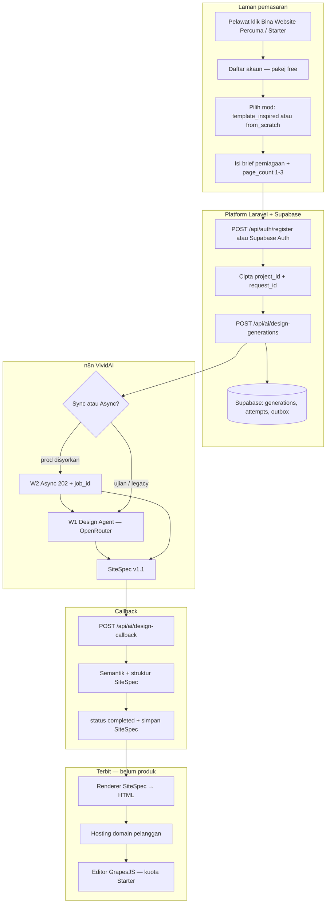

# Aliran pelanggan: Free / Starter plan → website (vividworks)

**Versi:** 1.0 (25 November 2026, UTC+8)  
**Audience:** ChatGPT, Cursor, dan pemilik produk  
**Penting:** Bahagian **SASARAN** menerangkan produk yang dirancang. Bahagian **SEMASA** menerangkan apa yang benar-benar hidup hari ini.

---

## 1. Ringkasan status komponen

| Komponen | Peranan | Status | Catatan |
|----------|---------|--------|---------|
| **Laman pemasaran** (`vividworks-site`) | UI BM, borang hubungi, pratonton templat | **Live preview** | https://preview.vividworks.my — Express API, **bukan** Laravel |
| **Laravel F1 API** (`laravel/` dalam repo) | `design-generations`, `design-callback`, inquiries | **Dibina + diuji** | Staging: `api-staging.vividworks.my` (dirujuk n8n). **Tidak** disambung ke laman pemasaran |
| **Supabase** `vividworks-staging` | Postgres untuk F1 | **Aktif** | 47 `generations`, inbox/callback/outbox — **tiada** jadual `users` / auth pelanggan |
| **n8n W1** “VividAI - Design Agent” | Webhook sync → OpenRouter → SiteSpec | **Diterbitkan** (`active`) | Terima `package: free` (dan grow/pro/elite). URL prod: `https://n8n.vividai.my/webhook/vividai/design-agent` |
| **n8n W2** “VividAI - Design Agent (Async)” | 202 + callback ke Laravel | **Draf** (`active: false`) | Stub “Kedai Contoh”, nod **Call Design Agent dilumpuhkan**. **Jangan terbitkan** tanpa kelulusan (rekod 22 Nov) |
| **Pendaftaran pelanggan / Starter RM0** | Akaun, kuota AI, editor | **Belum dibuka** | Marketing: butang → `/akan-datang` |
| **Renderer / terbit website** | HTML/CSS/JS pelanggan | **Luar skop repo marketing** | SiteSpec sahaja dalam F1 setakat ini |

**Kesimpulan jujur:** **AI Generate (W1) + Laravel + Supabase staging berjaya sebagai kepingan backend.** **Tiada satu aliran end-to-end** dari “pelanggan daftar free” hingga “website boleh dilihat” yang sudah disambungkan kepada laman pemasaran.

---

## 2. Aliran SASARAN (produk lengkap)



### Had pakej Starter (spesifikasi marketing, belum dilancarkan)

- RM0, 1–3 halaman statik, 1× AI Generate, 2× AI Edit (belum ada), GrapesJS selepas kredit habis, output HTML/CSS/JS, tiada DB khusus website pelanggan.

### Kontrak teknikal F1 (sudah dikunci dalam kod Laravel + n8n)

- `project_id` (≤64), `request_id` (≤100), `package` ∈ `free|grow|pro|elite`, `page_count` ∈ {1,2,3}, `active_templates` dari Laravel, callback ikat `job_id`, SiteSpec `schema_version` **1.1** sahaja.

---

## 3. Aliran SEMASA (apa yang pelanggan benar-benar alami)

```mermaid
flowchart LR
  subgraph today [Hari ini]
    T1[preview.vividworks.my]
    T2[/akan-datang]
    T3[POST /api/contact — Express]
    T4[(Fail inquiries pada container)]
  end

  T1 -->|Bina Website Percuma| T2
  T1 -->|Hubungi Kami| T3 --> T4

  subgraph backend [Backend F1 — tidak dari UI marketing]
    B1[api-staging.vividworks.my]
    B2[n8n W1 webhook]
    B3[Supabase staging]
  end

  T1 -.->|tiada pautan| B1
  B1 <-- callback --> B2
  B1 --> B3
```

---

## 4. Urutan mesej (Async — laluan produk disyorkan)

Ini menerangkan **W2 + Laravel** selepas pendaftaran wujud. W2 **belum diterbitkan**; ujian guna stub (lihat `docs/f1-dan-ujian-staging-2026-11-22.md`).

| Langkah | Pelaku | Tindakan | HTTP / hasil |
|--------|--------|----------|----------------|
| 1 | Frontend / Laravel | Pelanggan `package: free`, hantar brief + `active_templates` | — |
| 2 | Laravel | Persist generation + attempt, panggil n8n async webhook | — |
| 3 | n8n W2 | Validasi `project_id`, `request_id` | **202** + `job_id` |
| 4 | n8n | (Sasaran) panggil W1 atau model; (Sekarang) stub SiteSpec | — |
| 5 | n8n | `POST /api/ai/design-callback` ke Laravel | Bearer callback |
| 6 | Laravel | Semantik/struktur, kemas kini `generations` | 200 applied / 422 / 409 |
| 7 | Platform | (Belum) render + URL live + editor | — |

---

## 5. Urutan mesej (Sync — W1 sahaja)

Untuk ujian atau integrasi langsung tanpa W2:

1. Client `POST https://n8n.vividai.my/webhook/vividai/design-agent` + header `X-VividAI-Key`  
2. Badan termasuk `package: "free"`, `design_mode`, `business`, `page_count`, `active_templates`, dll.  
3. Respons sync: `status: ok` + `sitespec` **atau** ralat berstruktur (`schema_version` 1.1).  
4. Laravel boleh memanggil W1 dari `DesignGenerationService` (staging: stub `unknown` pada POST awam tanpa job_id — lihat doc F1).

---

## 6. Rujukan fail dalam repo

| Topik | Fail |
|-------|------|
| API Laravel | `laravel/routes/api.php` |
| Kitaran F1 + ujian staging | `docs/f1-dan-ujian-staging-2026-11-22.md` |
| Rancangan ujian n8n A7 | `vividworks-f1-a7-isolated-n8n-runtime-test-plan-v12.md` |
| Deploy marketing | `README.md` § Deployment |
| Audit sesi 24–25 Nov | `docs/PROJECT-AUDIT-2026-11-24.md` |

---

## 7. Langkah seterusnya untuk melengkapkan aliran free → website

1. **Auth & project** — Supabase Auth atau Laravel users; jadual `projects` / pautan `project_id` kepada akaun.  
2. **Ganti `/akan-datang`** — `VITE_SAAS_REGISTER_URL` + UI daftar yang memanggil backend.  
3. **Sambung marketing → Laravel** — env API staging/prod pada app SaaS (bukan Express marketing semasa).  
4. **Terbitkan W2** — hanya selepas `Call Design Agent` dihidupkan, kelulusan pemilik, dan ujian baki (item “Belum diuji” dalam doc F1).  
5. **Renderer + hosting** — terbitkan SiteSpec ke URL pelanggan; editor GrapesJS + kuota Starter.  
6. **Production** — `vividworks.my` marketing, prod DB, monitoring (lihat audit §7).

---

## 8. Changelog

| Tarikh | Perubahan |
|--------|-----------|
| 2026-11-25 | Draf awal: status komponen + Mermaid sasaran vs semasa |