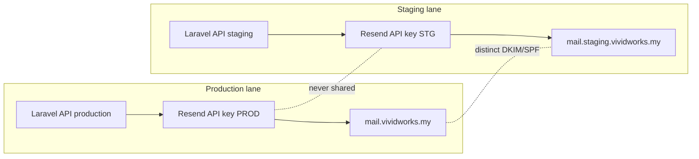

# A4.49 — VividWorks production & staging transactional email strategy (Resend)

**Date (UTC):** 2026-11-27  
**Project:** VividWorks Foundation & Identity  
**Provider:** Resend (both environments)  
**Mode:** Architecture and operational planning only — **no** accounts, DNS, credentials, packages, Coolify, migrations, I1 code, or email delivery

**Owner decisions recorded (not executed here):**

- **Resend approved for Staging** (A4.48).
- **Production-first transactional email identity strategy approved in principle** by Khairul (this document operationalizes candidates; domains/senders remain **candidates** until DNS and verification).

**Governing references:**

- [`A4.48-RESEND-DOMAIN-INTEGRATION-READINESS-2026-11-27.md`](./A4.48-RESEND-DOMAIN-INTEGRATION-READINESS-2026-11-27.md)
- [`A4.47-STAGING-EMAIL-PROVIDER-DECISION-2026-11-27.md`](./A4.47-STAGING-EMAIL-PROVIDER-DECISION-2026-11-27.md)
- [`A4.46-STAGING-EMAIL-READINESS-2026-11-27.md`](./A4.46-STAGING-EMAIL-READINESS-2026-11-27.md)
- [`FOUNDATION-IDENTITY-ARCHITECTURE-v1.0.1.md`](./FOUNDATION-IDENTITY-ARCHITECTURE-v1.0.1.md) (I1 verify/reset, **D-EMAIL-V**)
- [`I0-DECISION-RECORD-2026-11-27.md`](./I0-DECISION-RECORD-2026-11-27.md)

**Pre-I1 staging backup (accepted, not repeated):** `vividworks-staging_pre-i1_20261127T073909Z.dump` — [A4.45](./A4.45-STAGING-LOGICAL-BACKUP-REPORT-2026-11-27.md).

---

## 1. Unified architecture

VividWorks uses **one product pattern** for Laravel transactional mail (identity lifecycle) in **two isolated lanes**:

| Lane | Product role | Application | Typical API `APP_URL` (candidates) |
|------|----------------|-------------|--------------------------------------|
| **Production** | Primary customer identity and live SaaS | Production Laravel API host | `https://api.vividworks.my` (public A record observed; exact deploy URL **owner-confirmed**) |
| **Staging** | Pre-I1 / Gate 5 proof and integration tests | Staging Laravel on `vividworks-vm100` | `https://api-staging.vividworks.my` (A4.46 health **200**) |

**Transport:** `MAIL_MAILER=resend` on both lanes when configured.

**Out of scope for this stack (unchanged):** marketing **inquiry** email on the public/marketing app (**D-INQUIRIES**) — separate product path, not Laravel `MAIL_FROM_*` on API hosts.

**Design rules:**

1. **Production identity is canonical** for customer-facing transactional mail (`VividWorks` / `noreply@mail.vividworks.my` when verified).
2. **Staging never sends as Production** — separate Resend key, domain, and `MAIL_FROM_*`.
3. **Signed links** in verification and password-reset mail must match each environment’s **`APP_URL`** (architecture I1: `GET /api/email/verify/{id}/{hash}`).
4. **I1 implementation** remains behind **Gate 5**; this strategy prepares ops and DNS only.

---

## 2. Production and staging identity proposals (candidates)

| Field | Production (candidate) | Staging (candidate) |
|-------|------------------------|---------------------|
| Provider | Resend | Resend |
| Sending domain | `mail.vividworks.my` | `mail.staging.vividworks.my` |
| From address | `noreply@mail.vividworks.my` | `noreply@mail.staging.vividworks.my` |
| Display name | `VividWorks` | `VividWorks Staging` |
| Laravel `APP_ENV` (target) | `production` | `staging` (A4.46: staging host still reports **`production`** — **unresolved**) |
| Laravel `APP_URL` (target) | Production API HTTPS origin | `https://api-staging.vividworks.my` |

**Not approved by this document:** DNS publication, Resend domain add, or live sender use.

---

## 3. DNS readiness findings

### 3.1 Source matrix

| Source | Availability in A4.49 |
|--------|-------------------------|
| **Authoritative Cloudflare (read-only)** | **NOT VERIFIED** — no Cloudflare MCP/API on this run; Adapter MCP not authenticated. |
| **Public DNS (`dig`, supplementary)** | **Verified for this run** (record *counts* only; **values not reproduced**). |

### 3.2 Public DNS observations (2026-11-27)

Counts of returned RRs per type (0 = none seen at public resolver):

| Hostname | A | AAAA | CNAME | MX | TXT |
|----------|---|------|-------|----|-----|
| `vividworks.my` | 2 | 2 | 0 | 0 | 0 |
| `mail.vividworks.my` | 0 | 0 | 0 | 0 | 0 |
| `staging.vividworks.my` | 0 | 0 | 0 | 0 | 0 |
| `mail.staging.vividworks.my` | 0 | 0 | 0 | 0 | 0 |

**Related (context only, not mail domains):**

| Hostname | A count | Note |
|----------|---------|------|
| `api.vividworks.my` | 1 | Production API candidate origin |
| `api-staging.vividworks.my` | 2 | Staging API (A4.46) |

**Zone delegation (public):** `vividworks.my` NS → Cloudflare nameservers.

### 3.3 Authoritative Cloudflare findings

**NOT VERIFIED** for all of §3.2 hosts — pending read-only zone audit when access is available.

### 3.4 Suitability and conflict assessment

| Topic | Finding |
|-------|---------|
| **Vacancy of mail subdomains** | Public DNS shows **no** records on `mail.vividworks.my` or `mail.staging.vividworks.my` — **suitable for new Resend domain verification**, subject to Cloudflare confirmation. |
| **Naming isolation** | Staging mail under `mail.staging.vividworks.my` does not share FQDN with production mail or API hosts. |
| **SPF** | **NOT VERIFIED** at apex/parent labels via Cloudflare. Resend will supply SPF TXT for each **sending domain**; owners must check for existing SPF at `vividworks.my`, `staging.vividworks.my`, or parents to avoid multiple-SPF or wrong-include conflicts. |
| **DKIM** | **Pending** — record names/values **only** from Resend dashboard per domain (not documented here). |
| **DMARC** | **NOT VERIFIED.** If `_dmarc.vividworks.my` (or org-wide policy) exists, alignment for `mail.vividworks.my` and `mail.staging.vividworks.my` should be reviewed before production sends; staging can use stricter/literal staging subjects and From branding to reduce confusion even when DMARC passes. |
| **MX on mail subdomains** | None observed publicly; Resend transactional send typically does **not** require inbound MX on the sending domain (confirm in Resend UI per domain). |

**No Resend DNS record values** are invented in this report.

---

## 4. Resend account / project strategy

### 4.1 Recommended pattern (planning default)

| Element | Production | Staging |
|---------|------------|---------|
| **Resend scope** | Production sending domain + production API key | Staging sending domain + staging API key |
| **API keys** | **Dedicated** key stored only in Production Coolify/secret store | **Dedicated** key stored only on Staging (`vividworks-vm100`) |
| **Sending domains** | `mail.vividworks.my` | `mail.staging.vividworks.my` |
| **Cross-use** | **Forbidden:** staging key on production host; production key on staging host | **Forbidden** |

**Account structure (owner choice, not executed):**

| Option | Pros | Cons |
|--------|------|------|
| **A — One Resend org, two API keys + two domains** | Single billing/console; clear domain separation | Discipline required so staging env never receives prod key |
| **B — Two Resend projects/workspaces** | Harder to mix credentials | Slightly more admin overhead |

**Recommendation for planning:** **Option A or B** both satisfy isolation if **keys and domains are pairwise unique**; prefer **Option B** if team wants strongest blast-radius separation.

### 4.2 Per-environment provider requirements

| Requirement | Production | Staging |
|-------------|------------|---------|
| Domain added in Resend | `mail.vividworks.my` | `mail.staging.vividworks.my` |
| DKIM DNS | From Resend dashboard → Cloudflare | Same |
| SPF DNS | From Resend for **that** sending domain | Same |
| DMARC | Org policy review recommended before customer send | Staging policy may mirror or stay report-only — **owner decision NOT VERIFIED** |
| Sender identity | `noreply@…` on verified domain | `noreply@…` on verified domain |
| Pre-send gate | Dashboard domain **Verified** | Same |

### 4.3 Delivery testing and evidence

| Environment | Test inbox | Evidence (no secrets) |
|-------------|------------|------------------------|
| Staging | One **owner-approved** staging test address (A4.41 row 3) | UTC timestamp, provider message id, subject pattern, PASS/FAIL; **no** verification URLs or tokens in git |
| Production | Separate **owner-approved** prod test before go-live (not customer blast) | Same redaction rules |

**A4.49:** no messages sent.

---

## 5. Laravel integration requirements

**Repo:** `laravel/` (Laravel **13.x**).

### 5.1 Existing configuration

| File | Status |
|------|--------|
| `config/mail.php` | `resend` mailer defined; default `MAIL_MAILER` → `log` |
| `config/services.php` | `resend.key` ← `RESEND_API_KEY` |
| `.env.example` | No `RESEND_API_KEY`; `MAIL_MAILER=log` |

### 5.2 Composer

| Item | Status |
|------|--------|
| `resend/resend-php` in `composer.json` `require` | **Missing** |
| `laravel/framework` in `composer.lock` | **Suggests** `resend/resend-php` for Resend transport |
| Local `vendor/resend` | **Absent** in assessment workspace |

**Implementation-time (Gate 5 / approved deploy):** `composer require resend/resend-php` (version per framework suggestion); document `RESEND_API_KEY` in `.env.example` **name only** if desired.

### 5.3 Per-environment configuration (names only — not applied)

| Variable | Production (target) | Staging (target) |
|----------|---------------------|------------------|
| `MAIL_MAILER` | `resend` | `resend` |
| `RESEND_API_KEY` | Production-only secret | Staging-only secret |
| `MAIL_FROM_ADDRESS` | `noreply@mail.vividworks.my` | `noreply@mail.staging.vividworks.my` |
| `MAIL_FROM_NAME` | `VividWorks` | `VividWorks Staging` |
| `APP_ENV` | `production` | `staging` |
| `APP_URL` | Production API HTTPS | `https://api-staging.vividworks.my` |
| `FRONTEND_URL` / `SANCTUM_STATEFUL_DOMAINS` | I1+ SPA — production hosts | I1+ — staging hosts only |

**Staging today (A4.46):** mail vars present but empty-effective **`log`**; no I1 verification routes; no `users` table.

### 5.4 I1-related code (future — not in A4.49)

When Gate 5 authorizes I1, email flow depends on application code, not only Resend:

| Flow | Architecture touchpoint | Mail dependency |
|------|-------------------------|-----------------|
| Registration verify | `POST /api/register` + notification | Resend + signed `APP_URL` link |
| Verify click | `GET /api/email/verify/{id}/{hash}` | Correct `APP_URL` |
| Resend verification | I1 throttled endpoint | Same transport |
| Password reset | I1 reset notification | Same transport |

**No additional mail-specific code** beyond standard Laravel notifications is required for Resend beyond dependency + env — **unless** product chooses custom notification classes (engineering choice during I1).

---

## 6. Environment separation matrix

| Dimension | Production | Staging | Isolation rule |
|-----------|------------|---------|----------------|
| Resend API key | `RESEND_API_KEY` (prod) | `RESEND_API_KEY` (stg) | **Never copy across hosts or Coolify projects** |
| Sending domain | `mail.vividworks.my` | `mail.staging.vividworks.my` | Distinct DKIM/SPF per domain |
| `MAIL_FROM_ADDRESS` | `noreply@mail.vividworks.my` | `noreply@mail.staging.vividworks.my` | Staging must not use prod From |
| Coolify / secrets | Production API service env | Staging API on `vividworks-vm100` | Separate secret namespaces |
| `APP_ENV` | `production` | `staging` | Fix staging mislabel (A4.46) |
| `APP_URL` | Prod API origin | `https://api-staging.vividworks.my` | Drives signed verify/reset links |
| Delivery test inbox | Prod-approved test alias | Staging-approved test alias | No shared “one inbox for both” without explicit approval |
| Resend logs / message ids | Prod dashboard filter by domain/key | Staging dashboard | Use domain-scoped views for evidence |
| Marketing inquiry mail | Express/marketing stack | N/A for Laravel lane | Do not route inquiries through API `MAIL_FROM_*` |

---

## 7. Coolify environment variable mapping (planning)

Map **each Laravel API deployment** to a single lane. Variable **names** are identical; **values** must not cross environments.

| Coolify / runtime key | Production value source | Staging value source |
|-----------------------|-------------------------|----------------------|
| `MAIL_MAILER` | `resend` | `resend` |
| `RESEND_API_KEY` | Prod Resend secret (Coolify prod) | Stg Resend secret (Coolify stg) |
| `MAIL_FROM_ADDRESS` | Verified prod noreply | Verified stg noreply |
| `MAIL_FROM_NAME` | `VividWorks` | `VividWorks Staging` |
| `APP_ENV` | `production` | `staging` |
| `APP_URL` | Prod API public URL | `https://api-staging.vividworks.my` |

Optional (I1+): `FRONTEND_URL`, `SANCTUM_STATEFUL_DOMAINS`, session/cookie domain vars — **environment-paired**, not copied from prod to stg.

**A4.49:** no Coolify edits.

---

## 8. Deployment sequence (recommended)

Production-first **identity** does not require production API to go live before **staging mail proof**, but **brand and DNS** should follow a clear order to avoid rework.

| Phase | Scope | Authorization |
|-------|--------|---------------|
| **P0 — Decisions** | Approve final FQDNs, Resend account pattern (§4.1), test inboxes, production `APP_URL` | Khairul / Guru |
| **P1 — DNS + Resend (production mail domain)** | Add `mail.vividworks.my` to Resend; publish **dashboard-supplied** DNS in Cloudflare; verify | Separate ops checkpoint — **not A4.49** |
| **P2 — DNS + Resend (staging mail domain)** | Add `mail.staging.vividworks.my`; verify | Separate ops checkpoint |
| **P3 — Secrets** | Inject **separate** `RESEND_API_KEY` per Coolify target; set `MAIL_*`, fix staging `APP_ENV` | Ops on respective hosts only |
| **P4 — Application** | `composer require resend/resend-php`; deploy config to staging then prod when each environment is ready | Engineering after Gate 5 for I1 on staging |
| **P5 — Staging delivery proof** | Single test message after I1 verify notification exists (A4.41 row 3) | After I1 on staging |
| **P6 — Production delivery proof** | Single approved test before customer traffic | Before production I1/users |

**Staging I1** can proceed on **staging domain + staging key** while production mail domain is verified in parallel (P1 || P2), aligning with “production-first identity” in **branding/DNS ownership**, not necessarily staging blocked on prod send.

---

## 9. Decisions still requiring Khairul approval

| ID | Topic | Status |
|----|--------|--------|
| **D-MAIL-RESEND-STG** | Resend for staging | **Approved** |
| **D-MAIL-STRATEGY-PROD-FIRST** | Production-first transactional identity (dual domain) | **Approved in principle** |
| **D-MAIL-DOMAIN-PROD** | `mail.vividworks.my` | **Candidate** |
| **D-MAIL-DOMAIN-STG** | `mail.staging.vividworks.my` | **Candidate** |
| **D-MAIL-FROM-PROD / STG** | `noreply@…` + display names | **Candidates** |
| **D-RESEND-ORG-STRUCTURE** | Option A vs B (§4.1) | **Open** |
| **D-PROD-APP-URL** | Canonical production API URL for signed mail | **Open** (candidate `api.vividworks.my`) |
| **D-STG-APP-ENV** | Change staging from `production` → `staging` | **Open** (A4.46) |
| **D-DMARC-POLICY** | DMARC for apex/org and alignment with mail subdomains | **NOT VERIFIED** / open |
| **D-CF-ZONE-AUDIT** | Authoritative SPF/DMARC/TXT review | **Open** (Cloudflare access) |
| **D-TEST-INBOX-PROD / STG** | Approved addresses per environment | **Open** |
| **D-GATE-5-I1** | I1 implementation | **Not assumed** |

---

## 10. Recommended next checkpoint

**Suggested label:** **A4.50 (or ops runbook)** — *Resend domain verification & Cloudflare DNS (production + staging)*

**Entry criteria:**

1. Khairul confirms final candidate domains/senders (§2).
2. Resend account/project choice (§4.1).
3. Read-only **Cloudflare** zone audit authorized.

**Checkpoint outputs (future, not this task):**

- Authoritative record inventory for the four hostnames (§3).
- Resend domain add for **both** mail domains (separate authorization).
- Published DNS from Resend panel only.
- Verification status screenshot or ticket id (redacted).
- Still **no** cross-environment API keys.

**After verification + Gate 5:** staging `composer require resend/resend-php`, Coolify staging secrets, I1 deploy, staging single-message proof.

---

## Restrictions observed (A4.49)

| Restriction | Status |
|-------------|--------|
| No Resend accounts / keys | Observed |
| No DNS changes | Observed |
| No Coolify / runtime env changes | Observed |
| No package install or source changes | Observed |
| No I1 / migrations / email send | Observed |
| Report uncommitted / unpushed | Observed |

---

**STOP** — documentation complete. Await Guru and Khairul review.

**Prepared by:** Cloud Agent (A4.49 architecture & operations planning)