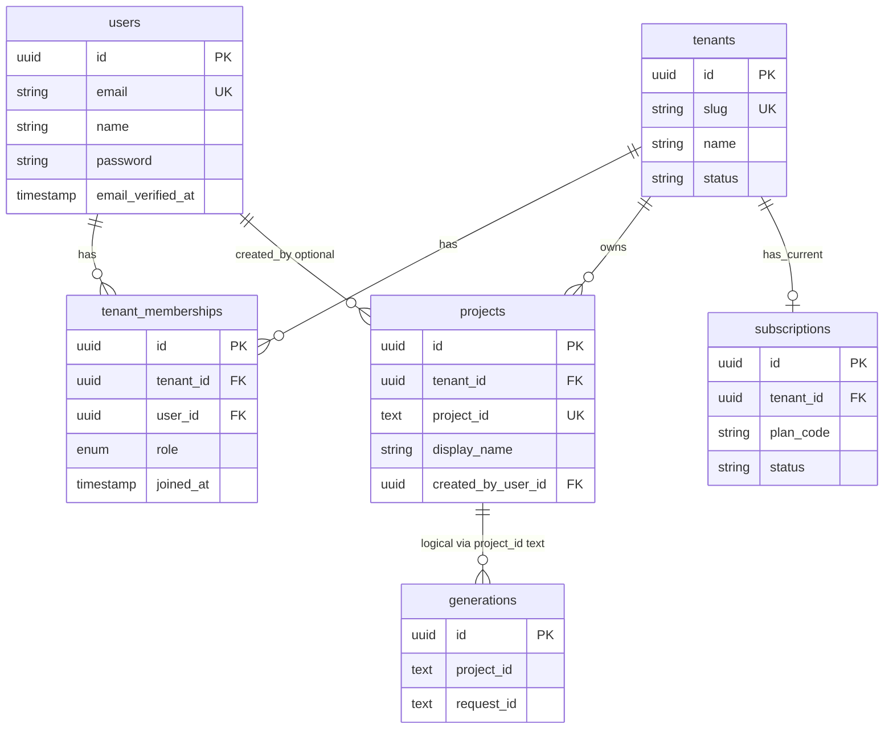
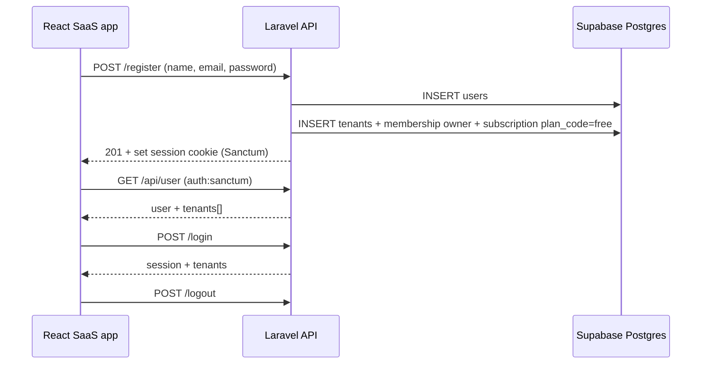

# VividWorks — Foundation & Identity Architecture (v1.0)

**Phase:** AUDIT & DESIGN ONLY  
**Project:** VividWorks SaaS  
**Backend:** Laravel 13 (`laravel/`)  
**Database:** Supabase Managed PostgreSQL (staging: `vividworks-staging`)  
**Authentication authority:** Laravel (bukan Supabase Auth)  
**Tarikh:** 25 November 2026 (UTC+8)  
**Status:** Menunggu kelulusan pemilik sebelum sebarang migrasi atau kod.

---

## Executive summary

Laravel dalam repo ini ialah **API F1 berasingan** dengan kitaran penjanaan AI yang matang (migrasi, model, ujian PHPUnit, data staging). **Tiada** jadual `users`, **tiada** migrasi auth, **tiada** pendaftaran/login, dan **tiada** jadual `tenants` / `projects` dalam kod atau staging Supabase setakat audit ini.

Keputusan seni bina yang dicadangkan:

- Laravel mengurus **users**, **tenants**, **tenant_memberships**, **projects**, dan **subscriptions** (tanpa billing).
- **`project_id` F1 kekal** sebagai rentetan teks ≤64 aksara (kontrak n8n/Laravel); jadual `projects` mengeluarkan nilai ini — **bukan** format UUID baru tanpa rancangan migrasi data.
- Pengesahan API untuk React: **Laravel Sanctum** (token + SPA cookie) di atas guard `web`/`sanctum`, dengan konteks tenant melalui header atau route parameter.
- F1: **tiada ubah** migrasi/kolum sedia ada; integrasi identiti melalui **jadual baharu + nullable FK atau validasi aplikasi** pada fasa implementasi berikutnya.

---

## 1. Fail yang diperiksa (inventori audit)

| Laluan | Tujuan |
|--------|--------|
| `laravel/composer.json` | Laravel **^13.17**, PHP ^8.3; tiada Sanctum/Breeze/Fortify |
| `laravel/bootstrap/app.php` | Routing API/web; tiada middleware auth global |
| `laravel/routes/api.php` | 5 endpoint API (health, contact, inquiries, design-generations, design-callback) |
| `laravel/routes/web.php` | Welcome sahaja |
| `laravel/config/auth.php` | Guard `web` session sahaja; model `User` |
| `laravel/config/database.php` | `pgsql` + `DATABASE_URL`; PHPUnit guna SQLite |
| `laravel/.env.example` | Supabase/postgres, `VIVIDAI_*`, `ADMIN_TOKEN` |
| `laravel/database/migrations/*` | 5 fail (inquiries + F1); **tiada** `users` / `sessions` |
| `laravel/app/Models/*` | User (skeleton), Generation*, CallbackInbox, Inquiry, … |
| `laravel/app/Support/Design*.php`, `F1MockDispatcher.php` | F1 invoke/callback |
| `laravel/app/Http/Middleware/*` | Callback token, contact limit, oversized JSON |
| `laravel/tests/**` | 9 fail ujian (F1, callback, generation, inquiry, SiteSpec) |
| `laravel/database/seeders/DatabaseSeeder.php` | Kosong — komen “Customer accounts are not part of this phase” |
| `docs/f1-dan-ujian-staging-2026-11-22.md` | Ujian staging W2 |
| `docs/WORKFLOW-FREE-PLAN-TO-WEBSITE.md` | Aliran produk |
| Supabase MCP `list_tables` (staging) | Snapshot 25 Nov 2026 |

**Tidak diubah:** tiada migrasi, SQL, kod, n8n, deploy, atau commit git semasa penyediaan dokumen ini.

---

## 2. Penemuan seni bina semasa (fakta repo + staging)

### 2.1 Laravel 13 application

- **Skop:** API JSON untuk inquiries + **F1 design generation**; bukan tapak pemasaran (`preview.vividworks.my` guna Express).
- **Packages:** `laravel/framework` ^13.17, `laravel/tinker`; **tiada** `laravel/sanctum`, **tiada** `laravel/breeze`.
- **User model:** `App\Models\User` (`Authenticatable`) dengan `name`, `email`, `password` — **tiada** migrasi `users` dalam repo.
- **Auth guards:** `web` → session sahaja; **tiada** `api` guard atau Sanctum.
- **Sessions:** `SESSION_DRIVER=file` dalam `.env.example`; **tiada** migrasi `sessions`.

### 2.2 API routes (sebenar)

```text
GET  /api/health
POST /api/contact          (LimitContactRequests)
GET  /api/inquiries        (Bearer ADMIN_TOKEN)
POST /api/ai/design-generations   (awam — DesignGenerationService)
POST /api/ai/design-callback       (X-VividAI-Callback-Token — n8n sahaja)
```

**Tiada** route register/login/tenant. `design-generations` **tidak** memerlukan user session.

### 2.3 Base data — migrasi dalam repo

| Migrasi | Jadual |
|---------|--------|
| `2026_10_25_000000_create_inquiries_table.php` | `inquiries` (skip jika wujud — preview DB) |
| `2026_11_16_130000_create_generations_table.php` | `generations` |
| `2026_11_16_130100_create_generation_attempts_table.php` | `generation_attempts` (+ indeks PG) |
| `2026_11_20_060000_create_generation_contexts_table.php` | `generation_contexts` |
| `2026_11_22_110000_f1_mock_async_lifecycle.php` | `callback_inbox`, `generation_outbox`, `generation_audit_events`, `generation_reopens` + lajur `invoke_correlation_key` |

### 2.4 Supabase staging (`vividworks-staging`, ref `tnvjesekmmnvbfevlwmd`)

**Jadual `public` (25 Nov 2026):**

| Jadual | Baris (anggaran) | RLS |
|--------|------------------|-----|
| `migrations` | 5 | on |
| `inquiries` | 1 | on |
| `generations` | 47 | on |
| `generation_attempts` | 50 | on |
| `generation_contexts` | 47 | on |
| `callback_inbox` | 38 | on |
| `generation_outbox` | 49 | on |
| `generation_audit_events` | 219 | on |
| `generation_reopens` | 2 | on |

**Tiada:** `users`, `tenants`, `projects`, `subscriptions`, atau jadual Supabase Auth (`auth.users` tidak disenaraikan dalam `public`).

**Konfigurasi:** Laravel `.env.example` menyokong `DB_CONNECTION=pgsql` dan `DATABASE_URL` — sesuai untuk Supabase connection string; PHPUnit **sentiasa** SQLite in-memory (F1 constraints sebahagian PG-only).

### 2.5 Kontrak F1 `project_id` / `request_id` (MUST NOT BREAK)

| Peraturan | Sumber |
|-----------|--------|
| `project_id` wajib, string, **max 64** aksara (trim) | `DesignGenerationService::validate` |
| `request_id` optional dalam generation validate? — required for persist with uniqueness | max **100** |
| Unik `(project_id, request_id)` pada `generations` dan `generation_contexts` | migrasi |
| n8n W2 pra-penerbangan: `project_id` + `request_id` wajib | workflow Prepare Job |
| Ujian staging guna rentetan seperti 64×`a`, 100×`b`, `project-001`, dll. | doc F1 / tests |
| **Bukan** UUID wajib — jenis DB: **`text`** | migrasi |

**`generations.id`:** UUID (dalaman). **`project_id`:** pengenalan perniagaan luaran / korelasi n8n — **kekal `text`**.

### 2.6 F1 lifecycle (ringkas)

```text
POST design-generations
  → persist Generation (status pending_invoke, dll.)
  → GenerationAttempt + GenerationContext + Outbox
  → DesignInvokeStub (default: unknown — tiada panggilan W2 langsung dalam mock)

POST design-callback (n8n)
  → callback_inbox → padan job_id / attempt
  → SiteSpec v1.1 → generations.sitespec, status terminal
```

Laravel ialah **otoriti** status attempt; `retryable` daripada n8n adalah diagnostik.

### 2.7 Ujian PHPUnit

| Fail | Skop |
|------|------|
| `F1MockLifecycleTest` | Mock dispatcher, resend, callback dup |
| `DesignGenerationTest` | Validasi input, stub HTTP 400/unknown |
| `DesignCallbackTest` | Callback besar, 409, 422, duplicate hash, … |
| `SiteSpec*ValidatorTest` | Semantik/struktur v1.1 |
| `InquiryApiTest` / `ContactRulesTest` | Marketing inquiries API |
| `CallbackPayloadHasherTest` | Hash kanonik |

Semua F1 feature tests: **SQLite** — komposit FK dan partial unique indexes **PostgreSQL-only** (diuji di staging manual).

### 2.8 Marketing site vs Laravel

- Repo root: React + Express; **tidak** berkongsi DB auth dengan Laravel.
- Pemasaran: tiada pelanggan/tenant.

---

## 3. Cadangan entiti identiti

### 3.1 Prinsip

1. **`tenants`** = organisasi/akaun bil (workspace). Setiap pelanggan SaaS biasanya satu tenant; power user boleh banyak tenant melalui membership.
2. **`projects`** = kontainer website/AI di bawah satu tenant; **`projects.project_id`** (text ≤64) ialah **nilai yang sama** dihantar ke F1/n8n.
3. **`users`** = identiti login Laravel.
4. **`tenant_memberships`** = many-to-many + peranan.
5. **`subscriptions`** = entitlements pakej (`free`/`grow`/`pro`/`elite`) — **tanpa** Stripe/invois dalam fasa ini.

### 3.2 ERD (cadangan)



**Nota F1:** Relasi `projects ||--o{ generations` pada fasa 1 adalah **logik** (`generations.project_id` = `projects.project_id`), bukan FK wajib dalam DB sehingga fasa migrasi data diluluskan.

### 3.3 Definisi jadual (cadangan)

#### `users`

| Lajur | Jenis | Kekangan |
|-------|-------|----------|
| `id` | `uuid` | PK, default `gen_random_uuid()` |
| `name` | `varchar(255)` | NOT NULL |
| `email` | `varchar(255)` | NOT NULL, **UNIQUE** |
| `password` | `varchar(255)` | NOT NULL |
| `email_verified_at` | `timestamptz` | NULL |
| `remember_token` | `varchar(100)` | NULL |
| `created_at` / `updated_at` | `timestamptz(6)` | |

Indeks: `users_email_unique` (sedia ada pattern Laravel).

#### `tenants`

| Lajur | Jenis | Kekangan |
|-------|-------|----------|
| `id` | `uuid` | PK |
| `slug` | `varchar(64)` | NOT NULL, UNIQUE (label URL/subdomain masa depan) |
| `name` | `varchar(255)` | NOT NULL |
| `status` | `varchar(32)` | NOT NULL, default `active` (`active`, `suspended`, `closed`) |
| `created_at` / `updated_at` | `timestamptz(6)` | |

Padam: **soft delete** (`deleted_at`) disyorkan untuk audit; F1 tidak terjejas.

#### `tenant_memberships`

| Lajur | Jenis | Kekangan |
|-------|-------|----------|
| `id` | `uuid` | PK |
| `tenant_id` | `uuid` | FK → `tenants.id`, ON DELETE CASCADE |
| `user_id` | `uuid` | FK → `users.id`, ON DELETE CASCADE |
| `role` | `varchar(16)` | NOT NULL — `owner`, `admin`, `member` |
| `invited_by_user_id` | `uuid` | NULL, FK → `users.id` |
| `joined_at` | `timestamptz(6)` | NOT NULL default now() |
| `created_at` / `updated_at` | `timestamptz(6)` | |

**UNIQUE** `(tenant_id, user_id)`.

**Peraturan:** sekurang-kurangnya satu `owner` per tenant (application-level + constraint trigger optional fasa 2).

Indeks: `(user_id)` untuk senarai tenant pengguna.

#### `projects`

| Lajur | Jenis | Kekangan |
|-------|-------|----------|
| `id` | `uuid` | PK (dalaman) |
| `tenant_id` | `uuid` | FK → `tenants.id`, ON DELETE RESTRICT |
| `project_id` | `text` | NOT NULL, **UNIQUE globally** |
| `display_name` | `varchar(255)` | NOT NULL |
| `created_by_user_id` | `uuid` | NULL, FK → `users.id` |
| `archived_at` | `timestamptz(6)` | NULL |
| `created_at` / `updated_at` | `timestamptz(6)` | |

**Mengapa `project_id` global unique:** F1 + n8n memadankan `(project_id, request_id)` tanpa `tenant_id` dalam payload. Duplikat global akan memecahkan callback. Tenant isolation: **projek hanya dicipta dalam tenant**, dan `project_id` dikeluarkan oleh Laravel (contoh: `vw_<tenantSlug8>_<ulid>` ≤64).

**JANGAN** tukar format staging sedia ada tanpa migrasi; projek baharu sahaja guna penjana baru.

#### `subscriptions` (future-ready, no billing)

| Lajur | Jenis | Kekangan |
|-------|-------|----------|
| `id` | `uuid` | PK |
| `tenant_id` | `uuid` | FK → `tenants.id` |
| `plan_code` | `varchar(16)` | NOT NULL — `free`, `grow`, `pro`, `elite` (selari n8n/Laravel packages) |
| `status` | `varchar(32)` | NOT NULL — `trialing`, `active`, `paused`, `cancelled` |
| `entitlements` | `jsonb` | NULL — kuota AI, page_count max, dll. |
| `starts_at` | `timestamptz(6)` | NOT NULL |
| `ends_at` | `timestamptz(6)` | NULL |
| `created_at` / `updated_at` | `timestamptz(6)` | |

**UNIQUE partial (cadangan):** satu langganan `active` per tenant (`UNIQUE (tenant_id) WHERE status = 'active'`) — PG only.

Tiada lajur pembayaran, Stripe ID, atau invois.

#### Jadual sokongan auth Laravel (fasa implementasi)

| Jadual | Keperluan |
|--------|-----------|
| `password_reset_tokens` | Laravel default |
| `sessions` | Jika SESSION_DRIVER=database untuk SPA |
| `personal_access_tokens` | Sanctum |

---

## 4. Autentikasi — satu pendekatan koheren

### 4.1 Keputusan dicadangkan

| Lapisan | Pilihan |
|---------|---------|
| Authority | **Laravel sahaja** (model `User`, password hash bcrypt) |
| API untuk React SPA | **Laravel Sanctum** — `auth:sanctum` pada API customer |
| Sesi browser | Cookie SPA + CSRF (`SANCTUM_STATEFUL_DOMAINS`) untuk domain `app.vividworks.my` / localhost |
| Mobile / third-party | Personal access tokens (Sanctum) dengan skop terhad |
| Email | `MustVerifyEmail` pada `User`; `MAIL_*` ke Resend/SES kemudian |
| Password reset | Laravel built-in `Password::sendResetLink` |
| n8n / design-callback | **Kekal** header `X-VividAI-Callback-Token` — **bukan** user auth |
| Admin inquiries | **Kekal** `ADMIN_TOKEN` berasingan |

**Tidak guna:** Supabase Auth, JWT custom selain Sanctum, OAuth sosial (fasa 2).

### 4.2 Aliran pendaftaran & login (cadangan)



**Route group cadangan (implementasi akan datang):**

- `POST /api/register`, `POST /api/login`, `POST /api/logout`
- `POST /api/email/verification-notification`, `GET /api/email/verify/{id}/{hash}`
- `POST /api/forgot-password`, `POST /api/reset-password`
- `GET /api/me`, `GET /api/tenants`, `POST /api/tenants/{tenant}/projects`

### 4.3 Penyelesaian konteks tenant

| Mekanisme | Cadangan |
|-----------|----------|
| Header | `X-Tenant-Id: <uuid>` pada setiap request selepas login |
| Validasi | Middleware `EnsureTenantMembership` — semak `tenant_memberships` untuk `auth()->id()` |
| Peranan | Policy: `owner`/`admin` boleh jemput ahli; `member` boleh cipta project jika entitlement membenarkan |
| Default tenant | Simpan `last_tenant_id` pada session atau pilih tenant tunggal auto |

**Jangan** embed `tenant_id` dalam JWT custom — gunakan Sanctum + header eksplisit (lebih mudah audit).

### 4.4 Pengasingan tenant (strategy)

1. **Query scoping:** Semua query `projects` / `subscriptions` WHERE `tenant_id = :resolved`.
2. **F1 gate:** Sebelum `POST design-generations`, Laravel resolve `project_id` → mesti row `projects` dengan `tenant_id` konteks.
3. **RLS Supabase:** Staging kini RLS **enabled** pada jadual F1. Laravel service role / connection string biasanya bypass RLS sebagai owner DB — **sahkan dengan pemilik**: sama ada RLS kekal dimatikan untuk role aplikasi atau policies ditambah fasa 2. **Jangan** guna RLS sebagai satu-satunya lapisan tanpa Laravel policies.
4. **n8n:** Tidak menerima `tenant_id` hari ini — isolation di **Laravel sebelum invoke** dan **pemilihan project_id yang dimiliki tenant**.

---

## 5. Integrasi F1 (tanpa ubah lifecycle sedia ada)

### 5.1 Rantaian sasaran

```text
tenant (subscription.plan_code=free)
  → project (projects.project_id text)
    → generation (generations.project_id match)
      → generation_attempt
```

### 5.2 Jadual F1 — impak identiti

| Jadual F1 | Ubah skema fasa 1? | Integrasi cadangan |
|-----------|-------------------|-------------------|
| `generations` | **Tidak** | Sebelum create: wujudkan `projects` row; `project_id` sama |
| `generation_attempts` | **Tidak** | Tiada |
| `generation_contexts` | **Tidak** | Tiada |
| `callback_inbox` | **Tidak** | Tiada |
| `generation_outbox` | **Tidak** | Tiada |
| `generation_audit_events` | **Tidak** | Optional: tambah `tenant_id` dalam JSON `context` sahaja |
| `generation_reopens` | **Tidak** | Tiada |
| `inquiries` | **Tidak** | Marketing berasingan |

### 5.3 FK masa depan (fasa 2+, selepas kelulusan)

| Tambahan | Faedah |
|----------|--------|
| `projects.id` UUID disimpan sebagai `generations.project_uuid` nullable | Join kuat |
| ATAU `generations.project_id` FK → `projects.project_id` | Referential integrity tanpa ubah jenis `text` |

**Data staging sedia ada (47 generations):** `project_id` ujian mungkin **tiada** row `projects` — migrasi backfill atau biarkan legacy tanpa FK (nullable enforcement).

### 5.4 Starter Free Plan (identiti → F1)

1. User daftar → tenant + `subscriptions.plan_code = 'free'`.
2. User cipta project → Laravel jana `project_id` (≤64).
3. User minta design → Laravel auth + tenant + entitlement check → `POST` logic sedia ada `DesignGenerationService` dengan `package: 'free'` dalam payload webhook (apabila W2/W1 dipanggil).
4. n8n/W2 **tidak** berubah kontrak `project_id`/`request_id`.

---

## 6. Susunan migrasi (cadangan, BELUM dilaksanakan)

```text
1. users
2. password_reset_tokens (Laravel)
3. tenants
4. tenant_memberships
5. subscriptions
6. projects
7. sessions (optional, if database sessions)
8. personal_access_tokens (Sanctum)
--- existing F1 migrations already applied on staging; do not re-run or edit ---
```

**Prasyarat staging:** backup / branch Supabase sebelum migrasi identiti.

---

## 7. Risiko & keputusan belum selesai (perlu pemilik)

| ID | Topik | Pilihan / soalan |
|----|-------|------------------|
| D-ID-1 | Format `project_id` baharu | Prefiks `vw_` + ULID vs UUID tanpa dash (≤64) |
| D-ID-2 | Unik global `project_id` vs per-tenant | Audit mengesyorkan **global unique** untuk F1/n8n |
| D-ID-3 | Backfill staging 47 generations | Cipta `projects` sintetik atau biarkan legacy |
| D-ID-4 | Supabase RLS untuk jadual baharu | RLS deny-all + service role vs Laravel-only |
| D-ID-5 | Satu tenant auto pada register vs pilih nama syarikat | UX onboarding |
| D-ID-6 | Email verification mandatory sebelum AI generate? | Keselamatan vs penukaran |
| D-ID-7 | Sanctum domains | Senarai `SANCTUM_STATEFUL_DOMAINS` prod/staging |
| D-ID-8 | `inquiries` vs tenant | Kekal berasingan (marketing) — disyorkan **ya** |
| D-FUTURE | nine OPEN items dari doc F1 (D-FUTURE, D-CID, …) | Masih terpakai pada F1, bukan identiti |

---

## 8. Urutan implementasi disyorkan (selepas kelulusan)

| Fasa | Kerja | Bergantung |
|------|-------|------------|
| **1a** | Pasang Sanctum + migrasi `users`, tokens, sessions | — |
| **1b** | Register/login/verify/reset API + tests | 1a |
| **1c** | `tenants`, `tenant_memberships`, policies | 1b |
| **1d** | `subscriptions` seed `free` on register | 1c |
| **1e** | `projects` CRUD + penjana `project_id` | 1d |
| **1f** | Middleware tenant + lindung `design-generations` | 1e |
| **1g** | Sambung React SaaS (ganti `/akan-datang`) | 1f |
| **2** | Optional FK/generations audit; backfill staging | 1f + D-ID-3 |
| **3** | Entitlements kuota AI (tanpa billing) | subscriptions + n8n package gate |

**Tidak sentuh:** migrasi F1 sedia ada, n8n W2 publish, data staging dipadam.

---

## 9. Kriteria penerimaan Fasa 1 implementasi

1. Pengguna boleh **daftar**, **sahkan e-mel**, **log masuk/log keluar**, **reset kata laluan** melalui API Laravel.
2. Setiap pengguna baru mendapat **tenant** dengan membership `owner` dan **subscription** `free`/`active`.
3. Pengguna boleh **buat project** di bawah tenant; `project_id` ≤64 dan **unik**; disimpan dalam `projects`.
4. `POST /api/ai/design-generations` menolak `project_id` yang **tidak** dimiliki tenant aktif (401/403/404).
5. **Tiada** regresi: PHPUnit F1 sedia ada lulus; staging F1 rows tidak diubah oleh migrasi identiti tanpa backfill dirancang.
6. **Tiada** Supabase Auth; tiada duplicate user store.
7. Dokumentasi env: `SANCTUM_STATEFUL_DOMAINS`, `FRONTEND_URL`, DB Supabase.
8. Audit trail: cipta project dicatat (optional `generation_audit_events` context atau log application).

---

## 10. Konflik dengan dokumentasi lama

| Dokumen lama | Fakta repo sekarang |
|--------------|---------------------|
| README “Not included: Laravel” (marketing) | Masih benar untuk **preview site**; Laravel wujud untuk **F1 API** |
| `DatabaseSeeder` “Customer accounts not part of this phase” | Masih benar — **belum** implementasi |
| Marketing pricing `free` id vs n8n `package: free` | Sama konsep; stored plan ids `free`/`starter`/… pada contact form kekal |

---

## 11. Lampiran — indeks status `generations` (rujukan kod)

Nilai `status` digunakan dalam F1 (rujuk model/tests): termasuk `pending_invoke`, `invoking`, `invoke_unconfirmed`, `accepted`, `completed`, `failed`, dll. Jadual identiti **tidak** menggantikan state machine ini.

---

## 12. Penutup audit

Laporan ini memenuhi fasa **AUDIT & DESIGN ONLY**. Fail disimpan pada:

**`docs/FOUNDATION-IDENTITY-ARCHITECTURE-v1.0.md`**

**Menunggu kelulusan eksplisit pemilik** sebelum:

- migrasi,
- Sanctum/Breeze,
- sebarang SQL pada Supabase staging/prod,
- atau perubahan route `design-generations`.

---

## Changelog dokumen

| Versi | Tarikh | Perubahan |
|-------|--------|-----------|
| 1.0 | 2026-11-25 | Audit repo + staging; cadangan identiti multi-tenant + F1 compatibility |