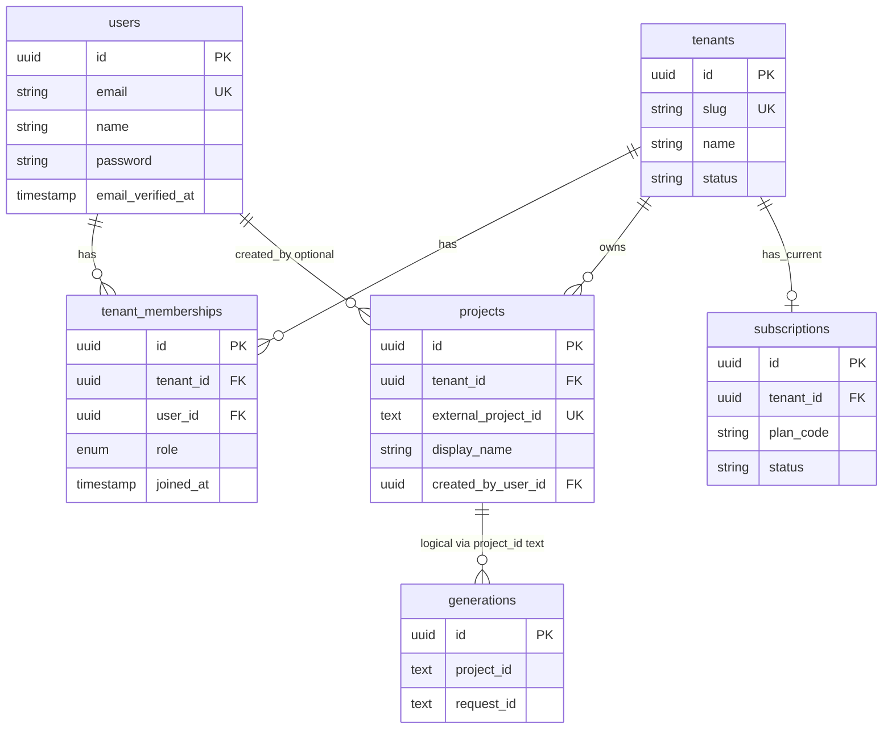

# VividWorks — Foundation & Identity Architecture v1.0.1

**Classification:** RECONSTRUCT AND RECONCILE (canonical implementation draft)  
**Status:** **Draft** — pending **Gate 3** owner approval  
**Effective date:** 27 November 2026 (UTC)  
**Repository:** `haizamk/vividworks-site`  
**Owner authority:** Khairul  

**Derived from:**

- [`FOUNDATION-IDENTITY-ARCHITECTURE-v1.0-ORIGINAL-2026-11-25.md`](./FOUNDATION-IDENTITY-ARCHITECTURE-v1.0-ORIGINAL-2026-11-25.md) (immutable archive)
- [`I0-DECISION-RECORD-2026-11-27.md`](./I0-DECISION-RECORD-2026-11-27.md) (nine I0 decisions + appended decisions)
- I0.2d / I0.2f reconciliation (A4.39, A4.40)

**Supersedes:** [`FOUNDATION-IDENTITY-ARCHITECTURE-v1.0.md`](./FOUNDATION-IDENTITY-ARCHITECTURE-v1.0.md) (condensed, 27 Nov 2026).

**Normative stack:** I0 Decision Record wins on conflict with this document until Gate 3 approval locks v1.0.1.

---

## 1. Document metadata and version history

| Version | Date | Change |
|---------|------|--------|
| 1.0 | 2026-11-25 | Original architecture — see ORIGINAL archive (not modified) |
| 1.0 (condensed) | 2026-11-27 | I0 closure summary — superseded |
| **1.0.1** | 2026-11-27 | Draft canonical doc; I1/I2 split; D-PHASE-SUB; D-ONBOARD-PHASE; `plan_code` closed |

---

## 2. Purpose, scope and F1 non-regression

**Purpose:** Define customer identity, multi-tenant SaaS, and project ownership for VividWorks **without** changing F1 design-generation contracts (state machine, callbacks, `project_id` / `request_id` semantics, or existing F1 table definitions).

**In scope:** Laravel as sole customer identity authority; Sanctum; tenants; memberships; projects; subscription **entitlements** (no payment gateway in I2); email verification gates; separation of marketing inquiries from tenant data.

**Out of scope (unchanged from original):** F1 semantic/schema edits; n8n W2 publication; production API exposure beyond documented health boundary (A4.31–A4.34); marketing production cutover.

**F1 non-regression (mandatory):**

- No edits to existing five F1 Laravel migrations in identity phases without explicit F1 gate.
- `project_id` ≤64, `request_id` ≤100; global unique `(project_id, request_id)`.
- n8n W1/W2 body contract for `project_id` / `request_id` unchanged.
- PHPUnit F1 suites must remain green after each identity phase on staging.

---

## 3. Normative technology stack

| Layer | Choice |
|-------|--------|
| Application | Laravel 13 (`laravel/`) |
| Database | Supabase Managed PostgreSQL (Laravel `pgsql` connection) |
| Customer auth authority | **Laravel only** (not Supabase Auth) |
| SPA / API auth | **Laravel Sanctum** (session cookies + CSRF; personal access tokens) |
| F1 integration auth | `VIVIDAI_CALLBACK_TOKEN`, `ADMIN_TOKEN` (unchanged, non-customer) |
| Email | Laravel mailer; `MustVerifyEmail` on `User` |

Stateful domains: per **D-SANCTUM**, defined during **I1** configuration (`SANCTUM_STATEFUL_DOMAINS`, CORS).

---

## 4. Full entity relationship diagram

Reconciled from original §3.2; subscription uses **`plan_code`** per **D-SUB-SCHEMA**.

**Note:** `projects.external_project_id` is a logical placeholder in this diagram — **OPEN — OWNER DECISION REQUIRED** for actual column name (**D-PROJECT-COL**: `project_id` vs `public_id`). The value stored must match F1 `generations.project_id` text.

**F1 linkage:** Logical only until optional future FK phase (original §5.3); no mandatory DB FK from `generations.project_id` in I1/I2.

---

## 5. Schema and column definitions

### 5.1 `users`

As original §3.3: UUID PK; `email` unique; `email_verified_at` nullable; Laravel conventions.

### 5.2 `tenants` / `tenant_memberships`

As original §3.3: `tenants.slug` unique; `tenant_memberships` unique `(tenant_id, user_id)`; roles `owner`, `admin`, `member`; at least one `owner` per tenant (application rule).

### 5.3 `subscriptions` (entitlement — I2; billing — I4)

**Official column name (CLOSED — D-SUB-SCHEMA):** `subscriptions.plan_code`.

| Column | Type | Notes |
|--------|------|-------|
| `id` | uuid | PK |
| `tenant_id` | uuid | FK → `tenants.id` |
| **`plan_code`** | varchar(16) | NOT NULL — `free`, `grow`, `pro`, `elite` (aligned with F1/n8n `package`) |
| **`status`** | varchar(32) | NOT NULL — includes **`active`** for Free entitlement |
| `entitlements` | jsonb | NULL — quotas (original); optional in I2 minimum |
| `starts_at` | timestamptz | NOT NULL |
| `ends_at` | timestamptz | NULL |
| timestamps | timestamptz | |

**I2 Free entitlement (D-PHASE-SUB):** on I2 onboarding completion, insert row with **`plan_code = free`**, **`status = active`**.

**I4 (commercial):** payment gateway fields, invoices, upgrades — additive migrations only; do not relocate Free entitlement creation to I4.

**Partial unique (original):** one `active` subscription per tenant where applicable.

**Do not** use `subscriptions.plan` as the canonical column name.

### 5.4 `projects`

**OPEN — OWNER DECISION REQUIRED (D-PROJECT-COL):** column name for the external F1 string:

| Option | Notes |
|--------|--------|
| `projects.project_id` | Original §3.3; same name as F1 column |
| `projects.public_id` | Audit §6.2 naming |

**Value format (CLOSED — D-PID-FMT):** new values use `vw_<tenantSlug8>_<ulid>` (max 64 chars). **D-PID-GLOBAL:** globally unique.

**D-EMAIL-V:** project **creation** API requires verified email.

### 5.5 Auth support tables (I1)

`password_reset_tokens`, `personal_access_tokens` (Sanctum), `sessions` if database sessions enabled.

---

## 6. Authentication architecture

- **Authority:** Laravel `User` + bcrypt; **D-EMAIL-V** mandatory before project create and F1 invoke (**I3**).
- **Sanctum:** `auth:sanctum` for customer API; SPA cookies + CSRF.
- **Unverified users:** may login and use limited SaaS (verify/resend); **cannot** create projects or invoke F1 (see audit §8.1 matrix).
- **Operational tokens:** callback and admin tokens unchanged (not user auth).

---

## 7. Registration and email verification flows

### I1 — identity (separate phase)

1. `POST /api/register` → create **`users`** row, `email_verified_at` null; send verification email.
2. Login/logout, resend verification, password reset — I1 scope.
3. **I1 does not** create tenant, membership, subscription, or project (**D-ONBOARD-PHASE**).

### Email verification

- `GET /api/email/verify/{id}/{hash}` (signed).
- Until verified: **no project create**, no F1 invoke (I3).

---

## 8. I2 onboarding flows (separate from I1)

**D-ONBOARD-PHASE:** I2 completes SaaS onboarding in **separate** API step(s) from I1 register — **not** one atomic database transaction with I1.

Typical sequence (conceptual):

1. User already exists from I1 (session valid).
2. `POST /api/onboarding` (or equivalent) → in one **I2** transaction:
   - personal **tenant**
   - **tenant_memberships** with role **`owner`**
   - **subscriptions** with **`plan_code = free`**, **`status = active`**
3. **Does not** auto-create projects.

**D-ONBOARD** intent preserved: each user receives a personal tenant through onboarding (completed in **I2**).

---

## 9. Tenant and owner membership

Created in **I2** only. Default personal tenant for new users; `owner` role on membership linking user to tenant.

---

## 10. Free subscription entitlement

**D-PHASE-SUB:** created in **I2**, not I4.

- `subscriptions.plan_code = free`
- `subscriptions.status = active`
- No payment provider columns in I2 minimum schema.

---

## 11. Project creation and identifier format

- **Gated by D-EMAIL-V** (verified middleware).
- **Not** part of I1 register or automatic I2 onboarding.
- Generator produces **D-PID-FMT** values; stored in `projects` table under column name **OPEN (D-PROJECT-COL)**.
- F1 `POST /api/ai/design-generations` (I3) must reject unknown or unowned `project_id`.

---

## 12. Tenant resolution and middleware

**OPEN — OWNER DECISION REQUIRED (D-TENANT-RES).**

Original proposal (reference only until closed):

- Header `X-Tenant-Id: <uuid>`
- Middleware `EnsureTenantMembership`
- Default tenant for single personal workspace

Options: header only, subdomain, session `last_tenant_id`, hybrid.

**I1:** no tenant-scoped routes required. **I2/I3:** resolution required before implementation of project and F1 guards.

---

## 13. F1 integration and generation authorization

- **I3:** protect `POST /api/ai/design-generations` — **D-GEN-AUTH** + **D-EMAIL-V** + tenant/project ownership.
- n8n callback: unchanged token middleware.
- F1 payload `package` remains; tenant entitlement read from `subscriptions.plan_code` at invoke time (future).

Target chain (from original §5.1): user → tenant → project (`project_id`) → F1 generation → n8n.

---

## 14. RLS and database access boundaries

**D-RLS:** Laravel controls application data access. Staging F1 tables may have RLS enabled with zero policies (A4.40) — confirm application DB role vs `BYPASSRLS` during **I1** configuration; do not alter RLS without explicit gate.

No PostgREST/anon direct access to F1 tables without policy design.

---

## 15. Legacy staging data preservation

**D-LEGACY-47:** preserve all existing staging F1 records; no backfill or cleanup in I0–I2 entry. Do not document fixed generation counts (A4.40 observed 49; may change).

---

## 16. Migration order mapped to I1 / I2

**I1 migrations (auth only):**

1. `users`
2. `password_reset_tokens`
3. `personal_access_tokens` (Sanctum)
4. `sessions` (optional, if database sessions)

**I2 migrations (onboarding + entitlement + projects):**

5. `tenants`
6. `tenant_memberships`
7. `subscriptions` (includes **`plan_code`**)
8. `projects` (column name per **D-PROJECT-COL** when closed)

**Existing F1 migrations:** already applied; do not re-run or edit.

**Prerequisite:** Supabase backup/snapshot before first identity migration on staging.

---

## 17. Original phases 1a–1g → I1–I6

| Original | Work | Current phase |
|----------|------|---------------|
| **1a** | Sanctum + user/token migrations | **I1** |
| **1b** | Register/login/verify/reset APIs | **I1** |
| **1c** | Tenants + memberships | **I2** |
| **1d** | Subscriptions Free on onboarding | **I2** (`plan_code=free`, `status=active`) |
| **1e** | Projects CRUD + ID generator | **I2** (after **verified**; not auto-onboarding) |
| **1f** | Tenant middleware + protect F1 | **I3** |
| **1g** | React SaaS UI | **I5** |
| **2** | Optional backfill / FK audit | **I6** (optional; D-LEGACY-47: no default backfill) |
| **3** | AI entitlements (no billing) | Post-I2 product; not payment gateway |
| **I4** | Billing, gateway, upgrades | **Not** in original 1a–1g entitlement row |

---

## 18. Acceptance criteria (reconciled)

**I1:**

1. Register, verify email, login/logout, reset password via Laravel API.
2. Unverified users cannot create projects or invoke F1 (guards may land in I2/I3 but criteria from **D-EMAIL-V**).
3. User implements `MustVerifyEmail`; no Supabase Auth.

**I2:**

1. Onboarding creates tenant + `owner` membership + subscription **`plan_code=free`**, **`status=active`**.
2. I1 and I2 are separate; not one atomic cross-phase transaction.
3. No automatic project creation on onboarding.

**I2/I3 (projects & F1):**

1. Verified user can create project; `project_id` value ≤64, globally unique.
2. F1 invoke rejects unowned `project_id` (I3).
3. F1 PHPUnit green; staging F1 rows unchanged without approved backfill.

**Environment:** `SANCTUM_STATEFUL_DOMAINS`, `FRONTEND_URL`, mail configuration documented.

---

## 19. Rollback, risks and environment

- DB snapshot before I1 (audit §10).
- Feature flag concept: `F1_PUBLIC_INVOKE` for emergency staging only (audit §10).
- Risks: public F1 endpoint until I3; CORS misconfiguration; dual auth — see original §7 and audit §12.

---

## 20. Document hierarchy and change control

| Precedence | Document |
|------------|----------|
| 1 | [`I0-DECISION-RECORD-2026-11-27.md`](./I0-DECISION-RECORD-2026-11-27.md) |
| 2 | **This file (v1.0.1)** after Gate 3 |
| 3 | [`FOUNDATION-IDENTITY-ARCHITECTURE-v1.0-ORIGINAL-2026-11-25.md`](./FOUNDATION-IDENTITY-ARCHITECTURE-v1.0-ORIGINAL-2026-11-25.md) (immutable) |
| 4 | [`FOUNDATION-IDENTITY-AUDIT-2026-11-25.md`](../FOUNDATION-IDENTITY-AUDIT-2026-11-25.md) (detail + clarifications) |
| 5 | [`FOUNDATION-IDENTITY-ARCHITECTURE-v1.0.md`](./FOUNDATION-IDENTITY-ARCHITECTURE-v1.0.md) (superseded condensed) |

**Gate 3** owner approval required before treating this document as canonical for implementation.

**Open decisions blocking full DDL lock:**

- **D-PROJECT-COL** — projects external string column name.
- **D-TENANT-RES** — tenant resolution mechanism.

---

*v1.0.1 draft prepared under Gate 2 documentation authorization. Implementation not authorized.*